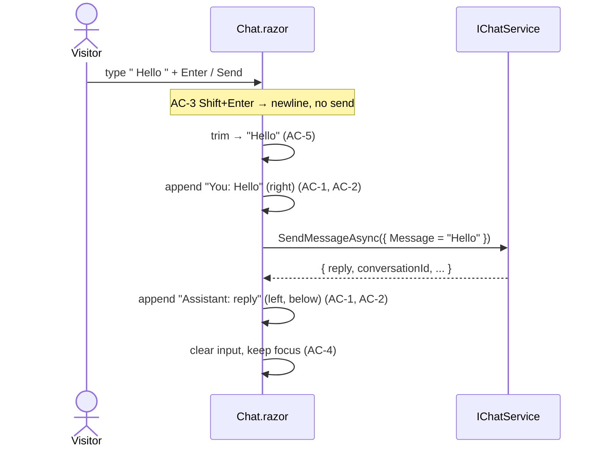
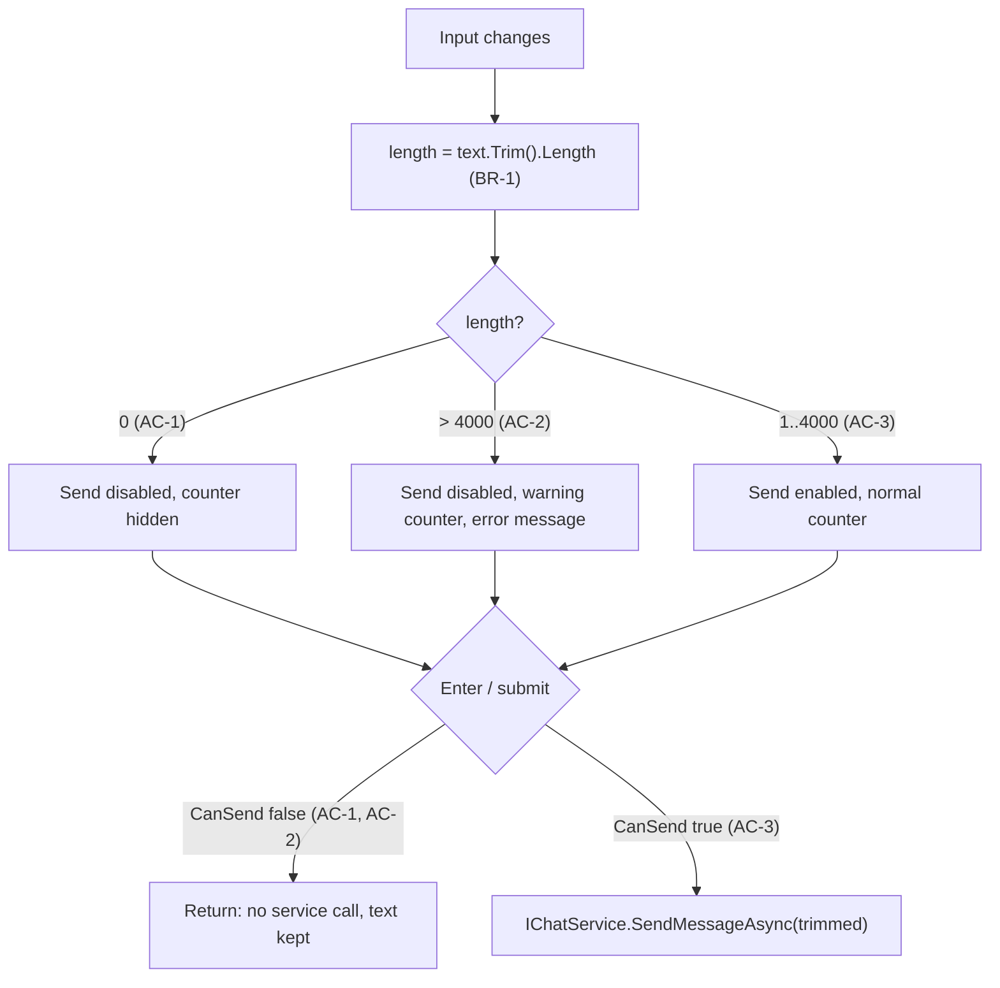

# Feature: Chatbot web UI

- Date: 2026-11-04
- Status: Implemented (US-1, US-2, US-3), Blazor Server + Radzen

## 1. User Stories

See [user-story/](user-story/README.md). US-1, US-2 and US-3 are done. US-4 to US-8 are out of scope for now.

## 2. Acceptance Criteria

As written in [US-1](user-story/US-1-send-and-receive.md): AC-1 to AC-5, BR-1.

Assumptions (US-1 only):
- No `conversationId` is sent (US-2).
- Validation, loading, errors, and safe rendering are covered by other stories. Message text is still inserted with `textContent` because it costs nothing.

## 3. Codebase notes

- Architecture: ASP.NET Core (.NET 10) controllers, `Program.cs` minimal hosting. `POST /api/chat` returns `{ conversationId, messageId, reply, createdAt }` ([ChatController.cs](../../Chatbot.Api/Controllers/ChatController.cs)).
- There is no frontend yet and no `wwwroot`. Static files are not enabled.
- Nearest neighbour for tests: [ChatEndpointTests.cs](../../Chatbot.Api.Tests/ChatEndpointTests.cs) (xUnit + `WebApplicationFactory`, `ChatbotApiFactory` uses the mock provider).
- Schema impact: none.
- Tests: `dotnet test` (xUnit + bUnit for the Blazor page).

## 4. Workflow

1. `GET /` renders the Blazor page `Components/Pages/Chat.razor` (Interactive Server).
2. User types → Enter (AC-3 sends) / Shift+Enter (AC-3 adds a newline, no send) / Send click.
3. Text is trimmed (AC-5). Body is `{ message: trimmed }` (BR-1).
4. Append "You" message, right-aligned (AC-1, AC-2).
5. `POST /api/chat` → append "Assistant" message with `reply`, left-aligned, below (AC-1, AC-2).
6. Clear input and keep focus (AC-4).

## 5. Change plan

- `Chatbot.Api/Program.cs`: `AddRazorComponents().AddInteractiveServerComponents()`, `UseAntiforgery()`, `MapStaticAssets()`, `MapRazorComponents<App>()`.
- `Chatbot.Api/Components/`: `App.razor`, `Routes.razor`, `_Imports.razor`, `Pages/Chat.razor`.
- `Chatbot.Api/wwwroot/chat.css`: styling (You on the right, Assistant on the left, `white-space: pre-wrap`).
- `Chatbot.Api/wwwroot/chat-keys.js`: stops Enter from inserting a newline (Shift+Enter still does).
- `Chatbot.Api.Tests/Components/ChatPageTests.cs`: bUnit tests with a fake `IChatService`.
- `Chatbot.Api.Tests/ChatEndpointTests.cs`: test that `/` serves the page.

## 6. Test plan

| # | AC | Test | Input | Expected | Contrast |
|---|----|------|-------|----------|----------|
| T1 | AC-1 | `GET /` serves chat page | GET `/` | 200, html with chat form | T2 |
| T2 | AC-1 | API routes unaffected | GET `/api/chat/{random}/messages` | 404 json, not html | T1 |
| T3 | AC-1 | send shows user msg then reply | "Hello", fetch → reply "Hi" | list = [You "Hello", Assistant "Hi"] | T4 |
| T4 | AC-1 | nothing sent → no messages | no send | list empty, fetch not called | T3 |
| T5 | AC-2 | roles/labels/order | two sends | user, assistant, user, assistant with classes + labels | T6 |
| T6 | AC-2 | assistant msg not styled as user | reply | class `assistant`, label "Assistant" (not "You") | T5 |
| T7 | AC-3 | Enter is send key | Enter, shift=false | true | T8 |
| T8 | AC-3 | Shift+Enter is not | Enter, shift=true | false | T7 |
| T9 | AC-4 | input cleared + focused after reply | send ok | value "", focus called | T10 |
| T10 | AC-4 | input not cleared before reply arrives | fetch pending | value still "Hello" | T9 |
| T11 | AC-5 | body trimmed | "  Hello  " | `{"message":"Hello"}` | T12 |
| T12 | AC-5 | inner spaces kept | "Hello  world" | `{"message":"Hello  world"}` | T11 |

## 7. Implementation report

US-1 was first built as plain HTML/JS, then converted to **Blazor Server (Interactive Server) inside Chatbot.Api**. The page injects `IChatService` directly instead of calling `POST /api/chat` over HTTP. Request content is the same (`ChatRequest { Message = trimmed }`, no `conversationId`).

All 20 tests pass with `dotnet test`: 10 bUnit tests for the page and 10 xUnit tests for the API and page hosting.

| AC | Tests ([ChatPageTests.cs](../../Chatbot.Api.Tests/Components/ChatPageTests.cs)) | Status |
|----|-------|--------|
| AC-1 | AC1_Send…, AC1_Contrast… and `Root_ServesChatPage` / `ApiRoutes_AreNotReplacedByChatPage` | Covered |
| AC-2 | AC2_Messages…, AC2_Contrast… | Covered |
| AC-3 | AC3_Enter_Sends, AC3_Contrast_ShiftEnter… | Covered (C# handler). The JS that blocks the Enter newline is not unit-tested. |
| AC-4 | AC4_AfterReply…, AC4_Contrast_WhilePending… | Covered |
| AC-5 | AC5_Message_IsTrimmed, AC5_Contrast_InnerSpaces… | Covered |

Mutation check: removing `Trim()` or inverting the Shift check makes 3 tests fail.

Files: [Components/](../../Chatbot.Api/Components/) (App, Routes, _Imports, Pages/Chat.razor), [wwwroot/chat.css](../../Chatbot.Api/wwwroot/chat.css), [wwwroot/chat-keys.js](../../Chatbot.Api/wwwroot/chat-keys.js), [Program.cs](../../Chatbot.Api/Program.cs).

Follow-ups: there is no error handling yet (US-6), and a failed send currently surfaces as a Blazor circuit error. The disabled state for empty input was added in US-3 (§9). The user stories still describe "plain HTML + JS", so update that stack assumption.

### UI library: Radzen Blazor

The page uses Radzen.Blazor 12.1 (Material theme): `RadzenStack`, `RadzenText`, `RadzenCard` bubbles, `RadzenTextArea` (`Immediate="true"` so Enter sends the current text) and `RadzenButton`. It is registered with `AddRadzenComponents()`, and `RadzenTheme` and `Radzen.Blazor.js` are loaded in `App.razor`. `chat.css` now only handles layout and uses Radzen CSS variables. The test ids (`#chat-input`, `#chat-form`, `#messages`) are unchanged.

## 8. US-2 Keep chatting in the same conversation

`Chat.razor` keeps `_conversationId`. The first send passes `null`, and each later send passes the id from the **latest** reply (BR-1). After each new message, `OnAfterRenderAsync` calls `chatScroll.toBottom` (in `wwwroot/chat-keys.js`) on the scroll container.

| AC | Tests | Status |
|----|-------|--------|
| AC-1 First message has no id | US2_AC1_FirstMessage_HasNoConversationId | Covered |
| AC-2 Follow-up reuses id | US2_AC2_FollowUp_ReusesReturnedConversationId (vs AC-1) | Covered |
| BR-1 Latest id wins | US2_BR1_UsesIdFromLatestResponse | Covered |
| AC-3 History stays | US2_AC3_EarlierMessages_StayInOrder_NewPairAtBottom | Covered |
| AC-4 Auto-scroll | US2_AC4_NewMessages_ScrollToLatest vs US2_AC4_Contrast_NoNewMessages_NoScroll | Covered (JS call verified; the scrolling itself is not unit-tested) |

Mutation check: always sending `ConversationId = null` makes the AC-2 and BR-1 tests fail. 26/26 tests pass.

Follow-ups: the id lives only in page memory, so a reload loses it (US-5). An unknown or deleted conversation (404) is unhandled (US-6).

## 9. US-3 Block invalid messages

AC: [US-3](user-story/US-3-input-validation.md), AC-1 to AC-4 (AC-5 dropped), BR-1, BR-2.

### Codebase notes

- `Chat.razor` already trims and ignores empty text in `SendAsync`, but the Send button is never disabled and there is no length check.
- `_text` is bound with `Immediate="true"`, so every keystroke re-renders the page. The counter and the disabled state can be computed properties.
- The 4000 limit only exists as `[MaxLength(4000)]` on `ChatRequest`. The API has no 4000/4001 test.
- Tests: bUnit in [ChatPageTests.cs](../../Chatbot.Api.Tests/Components/ChatPageTests.cs) (`InputAsync`, `SubmitAsync`, `KeyDownAsync`, `FakeChatService.Requests`) and xUnit API tests in [ChatEndpointTests.cs](../../Chatbot.Api.Tests/ChatEndpointTests.cs). Baseline: 26/26 pass.

### Workflow

1. On every input, the page computes `length = _text.Trim().Length` (BR-1).
2. `length == 0` → Send disabled, counter hidden (AC-1, AC-4).
3. `length > 4000` → Send disabled, counter `n / 4000` in the warning style, error "Message must be 4000 characters or fewer" replaces the hint (AC-2, AC-4).
4. `1..4000` → Send enabled, counter `n / 4000` in the normal style (AC-3, AC-4).
5. Enter or submit → `SendAsync` checks the same `CanSend` rule. If it fails, return without calling `IChatService` and keep the text (AC-1, AC-2).

### Change plan

- [ChatRequest.cs](../../Chatbot.Api/DTOs/ChatRequest.cs): add `public const int MaxMessageLength = 4000;` and use it in `[MaxLength(MaxMessageLength)]`, so the page and the API share one limit (BR-2).
- [Chat.razor](../../Chatbot.Api/Components/Pages/Chat.razor): add the `Length`, `TooLong` and `CanSend` properties. `RadzenButton Disabled="@(!CanSend)"`. `SendAsync` guards on `CanSend`. Add a counter `#char-count` (class `over` above the limit). Add an error `#chat-error` (`role="alert"`) that replaces the hint.
- [chat.css](../../Chatbot.Api/wwwroot/chat.css): add a footer row with the hint/error on the left and the counter on the right, plus warning colours.
- Tests: new US-3 section in `ChatPageTests.cs` and a 4000/4001 pair in `ChatEndpointTests.cs`.
- No schema or migration change.

### Test plan

| # | AC | Test | Input | Expected | Contrast |
|---|----|------|-------|----------|----------|
| T1 | AC-1 | `US3_AC1_WhitespaceOnly_SendDisabled` | "   " | button disabled | T2 |
| T2 | AC-1 | `US3_AC1_Contrast_Text_SendEnabled` | "Hello" | button enabled | T1 |
| T2b | AC-1 | `US3_AC1_FreshPage_SendDisabled` | nothing typed | button disabled | T2 |
| T3 | AC-1 | `US3_AC1_WhitespaceOnly_EnterAndSubmit_DoNotSend` | "   " + Enter + submit | no request | `AC3_Enter_Sends` (US-1) |
| T4 | AC-2 | `US3_AC2_TooLong_SendDisabled_ErrorShown` | 4001 × "a" | button disabled, `#chat-error` text, no hint | T6 |
| T5 | AC-2 | `US3_AC2_TooLong_EnterAndSubmit_DoNotSend_TextKept` | 4001 × "a" + Enter + submit | no request, input still has 4001 chars, no messages | T6 |
| T6 | AC-3 | `US3_AC3_Exactly4000_IsSent` | 4000 × "a" | enabled, no error, 1 request of length 4000 | T4, T5 |
| T7 | AC-3 | `US3_AC3_4000PlusOuterSpaces_IsSent_Trimmed` | "  " + 4000 × "a" + "  " | sent, message length 4000 (BR-1) | T4 |
| T8 | AC-2 | `US3_AC2_ShortenedBackToLimit_ErrorClears` | 4001 → 4000 | error gone, hint back, button enabled | T4 |
| T9 | AC-4 | `US3_AC4_Counter_ShowsTrimmedLength` | "  Hi  " | `#char-count` = "2 / 4000", no `over` class | T10, T11 |
| T10 | AC-4 | `US3_AC4_Contrast_OverLimit_CounterWarns` | 4001 × "a" | "4001 / 4000", class `over` | T9 |
| T11 | AC-4 | `US3_AC4_Contrast_EmptyOrWhitespace_NoCounter` | fresh page, then "   " | no `#char-count` | T9 |
| T12 | BR-2 | `SendMessage_With4000Chars_Returns200` (API) | 4000 × "a" | 200 | T13 |
| T13 | BR-2 | `SendMessage_With4001Chars_Returns400` (API) | 4001 × "a" | 400 | T12 |

Decision: whitespace-only input counts as empty (trimmed length 0, BR-1), so the counter stays hidden for it.

### Implementation report

US-3 is done. All 40 tests pass with `dotnet test` (26 before, 12 new page tests, 2 new API tests), and the build has no warnings.

| AC | Tests | Status |
|----|-------|--------|
| AC-1 Empty can't be sent | `US3_AC1_WhitespaceOnly_SendDisabled` vs `US3_AC1_Contrast_Text_SendEnabled`, `US3_AC1_FreshPage_SendDisabled`, `US3_AC1_WhitespaceOnly_EnterAndSubmit_DoNotSend` | Covered |
| AC-2 Over 4000 can't be sent | `US3_AC2_TooLong_SendDisabled_ErrorShown`, `US3_AC2_TooLong_EnterAndSubmit_DoNotSend_TextKept`, `US3_AC2_ShortenedBackToLimit_ErrorClears` | Covered |
| AC-3 Exactly 4000 allowed | `US3_AC3_Exactly4000_IsSent`, `US3_AC3_4000PlusOuterSpaces_IsSent_Trimmed` (vs AC-2) | Covered |
| AC-4 Counter | `US3_AC4_Counter_ShowsTrimmedLength` vs `US3_AC4_Contrast_OverLimit_CounterWarns`, `US3_AC4_Contrast_EmptyOrWhitespace_NoCounter` | Covered |
| BR-2 Same limit as API | `SendMessage_With4000Chars_Returns200` vs `SendMessage_With4001Chars_Returns400` | Covered (these pass on existing behaviour and guard the shared constant) |

Mutation check:
- Changing the limit check from `>` to `>=` breaks 3 tests (AC-2 recovery, both AC-3 tests).
- Removing the `CanSend` guard in `SendAsync` breaks 2 tests (Enter/submit for AC-1 and AC-2).

Files:
- [ChatRequest.cs](../../Chatbot.Api/DTOs/ChatRequest.cs): `MaxMessageLength = 4000`, used by `[MaxLength]`.
- [Chat.razor](../../Chatbot.Api/Components/Pages/Chat.razor): `Length` / `TooLong` / `CanSend`, disabled Send, `#chat-error`, `#char-count`, guard in `SendAsync`.
- [chat.css](../../Chatbot.Api/wwwroot/chat.css): `.composer-footer`, `.hint-error`, `.counter` / `.counter.over`, disabled Send style, `--chat-error` colour (light and dark).
- [ChatPageTests.cs](../../Chatbot.Api.Tests/Components/ChatPageTests.cs), [ChatEndpointTests.cs](../../Chatbot.Api.Tests/ChatEndpointTests.cs).

Follow-ups:
- The new layout and colours have only been checked through bUnit's HTML, not in a browser.
- Blazor Server sends every keystroke over SignalR. A very large paste (roughly >32 KB, the default SignalR message limit) could drop the circuit before the warning shows. 4000 characters is well within the limit.
- Send is still enabled while a reply is pending (US-4).
