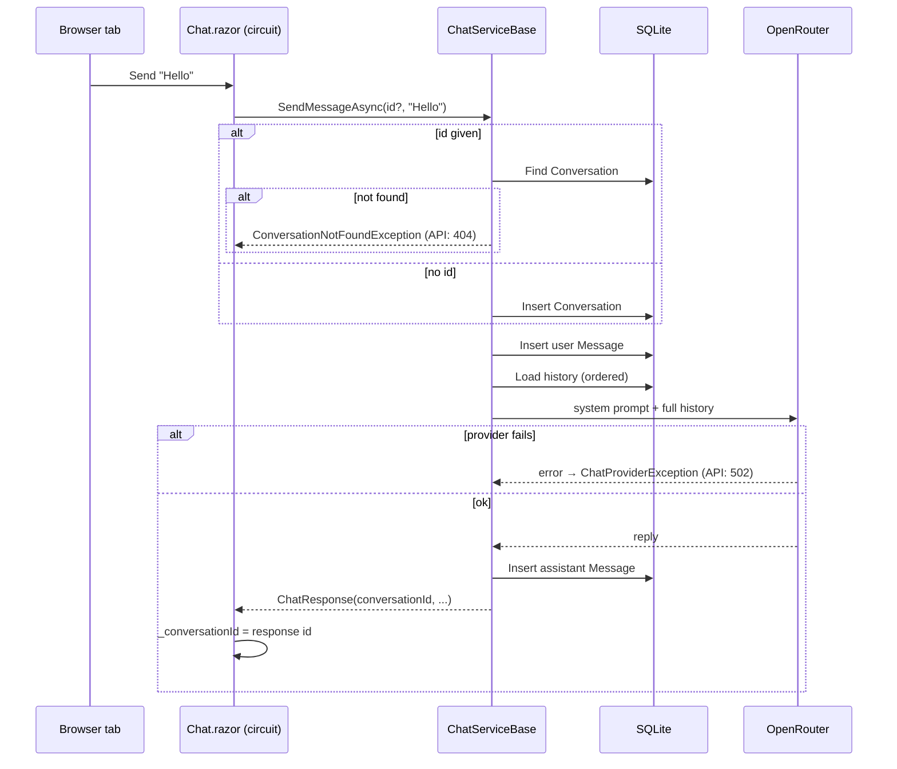

# How the Chat Session Works

Date: 2026-11-04 · Commit: d554049 · Scope: conversation ("session") design — `conversationId` lifecycle, persistence, Blazor circuit state, and the planned US-5 restore

## 1. At a Glance

There are no user accounts or cookies. A **session is a `Conversation` row in SQLite, identified by a GUID** (`conversationId`). The server creates the id and returns it, and the page sends it back with every message. Today the page keeps the id only in memory, so a reload loses it. [US-5](../user-story/US-5-restore-after-reload.md) (planned) will save it in `localStorage`.

**Why:** ✅ [US-2](../user-story/US-2-continue-conversation.md) — "so that the assistant remembers the context". BR-1: the id always comes from the latest server response; the client never generates one.

| | |
|---|---|
| Entry points | Chat page `/` (Blazor), `POST /api/chat`, `GET /api/chat/{id}/messages` |
| Main code | [Chat.razor](../../../Chatbot.Api/Components/Pages/Chat.razor), [ChatServiceBase.cs](../../../Chatbot.Api/Services/ChatServiceBase.cs), [ChatController.cs](../../../Chatbot.Api/Controllers/ChatController.cs), [OpenRouterChatService.cs](../../../Chatbot.Api/Services/OpenRouterChatService.cs) |
| Data | `Conversations` 1 → many `Messages` ([ChatbotDbContext.cs](../../../Chatbot.Api/Data/ChatbotDbContext.cs)) |
| External systems | OpenRouter (LLM), or `MockChatService` (echo) when no API key is set |
| Tests to read first | [ChatEndpointTests.cs](../../../Chatbot.Api.Tests/ChatEndpointTests.cs), the `US2_*` tests in [ChatPageTests.cs](../../../Chatbot.Api.Tests/Components/ChatPageTests.cs) |

## 2. Entry Points

| Method | URL / trigger | Auth | Purpose | Handler |
|---|---|---|---|---|
| UI | Send on `/` | none | Send a message from the page | `Chat.razor` `SendAsync` → `IChatService` directly (no HTTP) |
| POST | `/api/chat` | none | Send a message (API clients) | `ChatController.SendMessage` |
| GET | `/api/chat/{conversationId:guid}/messages` | none | Read a conversation's history | `ChatController.GetMessages` |

The three layers of "session":

| Layer | Where it lives | Lifetime |
|---|---|---|
| **Conversation** (the real session) | SQLite `Conversations` + `Messages` | Forever (nothing deletes it) |
| **Page state** (`_conversationId`, `_messages`) | Server memory, in the Blazor Server circuit | Until the tab reloads/closes or the connection drops |
| **Saved id** *(US-5, planned)* | Browser `localStorage`, key `chatbot.conversationId` | Until cleared (404, or US-7 "New chat") |

## 3. Workflow

### 3.1 Step by Step

1. **User sends.** `SendAsync` in [Chat.razor](../../../Chatbot.Api/Components/Pages/Chat.razor) builds `ChatRequest { ConversationId = _conversationId, Message = trimmed }`. On the first message the id is `null`.
2. **Find or create.** [ChatServiceBase.cs](../../../Chatbot.Api/Services/ChatServiceBase.cs) `SendMessageAsync`: with an id, it's looked up, and an unknown id throws `ConversationNotFoundException` (API → 404). With no id, a new `Conversation` is created, titled from the first 60 characters.
3. **User message saved** (first `SaveChangesAsync`) *before* the LLM is called.
4. **Full history loaded**, ordered by `CreatedAt`, and passed to the provider. [OpenRouterChatService.cs:33-39](../../../Chatbot.Api/Services/OpenRouterChatService.cs#L33-L39) adds the system prompt in front, then the last `MaxHistoryMessages` (default 20) messages. **This is how the assistant "remembers"**: the conversation is re-sent every call. The model keeps no state. A provider failure becomes `ChatProviderException` (API → 502).
5. **Assistant reply saved** (second `SaveChangesAsync`) → returns `ChatResponse(ConversationId, MessageId, Reply, CreatedAt)`.
6. **Page stores the returned id** in `_conversationId` (BR-1) and shows the reply.

### 3.2 Diagram

A sequence diagram, because the flow crosses page → service → DB → LLM with error branches.



## 4. DTOs (Request & Response)

**Request** — `POST /api/chat`, [ChatRequest.cs](../../../Chatbot.Api/DTOs/ChatRequest.cs)

```json
{ "conversationId": "3f2b8c1e-6a4d-4e0f-9b7a-2c5d1e8f4a90", "message": "And in Python?" }
```

| Field | Type | Required | Validation | Maps to | Meaning |
|---|---|---|---|---|---|
| `conversationId` | Guid? | no | must exist, else 404 | `Conversations.Id` | Which session to continue; leave it out to start a new one |
| `message` | string | yes | not empty, max 4000 | `Messages.Content` (role `user`) | What the user typed (the page trims it) |

**Response** — [ChatResponse.cs](../../../Chatbot.Api/DTOs/ChatResponse.cs)

```json
{ "conversationId": "3f2b8c1e-6a4d-4e0f-9b7a-2c5d1e8f4a90", "messageId": "a1c9…", "reply": "In Python you can…", "createdAt": "2026-11-04T09:15:02Z" }
```

| Field | Comes from | Meaning |
|---|---|---|
| `conversationId` | `Conversations.Id` | The id to send next time (BR-1) |
| `messageId` | `Messages.Id` (assistant row) | The saved reply |
| `reply` | `Messages.Content` | Assistant text |
| `createdAt` | `Messages.CreatedAt` | When the reply was saved (UTC) |

**History** — `GET /api/chat/{id}/messages` → `ConversationDto { id, title, createdAt, messages[] }`, where each message is `{ id, role, content, createdAt }` ([ConversationDto.cs](../../../Chatbot.Api/DTOs/ConversationDto.cs)). US-5 will use this to restore the chat.

**Errors**: `ProblemDetails` — 400 (validation), 404 "Conversation not found", 502 "Chat provider error".

**Deliberately missing:** no user or owner field. There are no accounts; the GUID is the key.

## 5. Business Rules & Why

| Rule | Where | Why | Test |
|---|---|---|---|
| The client never makes an id; it always uses the latest response's id | `Chat.razor` `SendAsync` | ✅ US-2 BR-1 | `US2_BR1_UsesIdFromLatestResponse` |
| An unknown id is an error, never a silent new conversation | `ChatServiceBase.SendMessageAsync` | 💭 a follow-up shouldn't land in an empty context unnoticed | `SendMessage_WithUnknownConversation_Returns404` |
| The user message is saved before the LLM call | `ChatServiceBase` | 💭 the question survives a provider failure | — |
| The system prompt is not stored, only added per call | [OpenRouterChatService.cs:33](../../../Chatbot.Api/Services/OpenRouterChatService.cs#L33) | 💭 prompt changes apply to old conversations too | — |

## 6. Data Touched

- `Conversations`: `Id` (GUID stored as TEXT), `Title` (max 200), `CreatedAt`.
- `Messages`: `Id`, `ConversationId` (FK, cascade delete), `Role` (`user`/`assistant`), `Content`, `CreatedAt`; index on `(ConversationId, CreatedAt)` for ordered history reads.
- SQLite via EF Core 10; migrations applied on startup (`db.Database.Migrate()` in [Program.cs](../../../Chatbot.Api/Program.cs)). SQLite does not enforce the `HasMaxLength` limits.

## 7. Gotchas

- **A reload loses the chat today** → the id lives only in the circuit → US-5 adds `localStorage`; read it only in `OnAfterRenderAsync(firstRender)`, because JS interop isn't available while the page is prerendered.
- **A failed provider call leaves a user message with no reply** → it's saved before the call → restored histories (US-5) can show it; the error UI belongs to US-6.
- **Two saves, no transaction around both** → if the reply save fails, you get the same orphaned user message.
- **The model only sees the last 20 messages** → `history.TakeLast(MaxHistoryMessages)` in [OpenRouterChatService.cs:36-38](../../../Chatbot.Api/Services/OpenRouterChatService.cs#L36-L38), default 20 (`OpenRouter:MaxHistoryMessages`) → older turns are silently forgotten by the model, although the page and the DB still show them. Change the config value, not the code.
- **The GUID is the only access control** → anyone with the id can `GET` the history → acceptable without accounts; revisit if auth is added.
- **Tests never call OpenRouter** → `MockChatService` (no API key) for API tests, `FakeChatService` in bUnit.
- **`system` messages are never stored** → the US-5 plan's "hide system messages" rule is a safety net only.

## 8. Try It Yourself

```bash
dotnet test --filter "FullyQualifiedName~US2|FullyQualifiedName~ChatEndpointTests"
```

With [Chatbot.Api.http](../../../Chatbot.Api/Chatbot.Api.http) or Swagger (`/swagger`): `POST /api/chat` with `{ "message": "Hello" }` → copy `conversationId` → `POST` again with it → `GET /api/chat/{id}/messages`.

Breakpoints: `Chat.razor` `SendAsync` → `ChatServiceBase.SendMessageAsync` (the find-or-create branch) → `OpenRouterChatService.GenerateReplyAsync`.

## 9. Glossary · Check Your Understanding · Next Steps

**Glossary**
- **Conversation** — one chat thread; the real "session".
- **Circuit** — a tab's live Blazor Server (SignalR) connection; it holds page state on the server.
- **Prerendering** — the server renders the page once as HTML before the circuit connects; no JS interop then.
- **BR-1** — the rule that the id always comes from the server.

**Check your understanding**

<details><summary>What happens if you send a random GUID as conversationId?</summary>404 — no new conversation is created.</details>
<details><summary>Why does the assistant remember earlier messages?</summary>Every call re-sends the stored history (last 20 messages) to the model.</details>
<details><summary>Why does reloading lose the chat today?</summary>The id is held only in the circuit's memory; US-5 adds localStorage.</details>
<details><summary>Can a provider failure leave data behind?</summary>Yes — the user message is already saved, with no assistant reply.</details>

**Open questions for the team**
- Should old conversations ever be deleted (retention)?
- Is a GUID alone acceptable as access control long-term?
- Is a 20-message window enough, or should older turns be summarized instead of dropped?

**Where to go next**: [US-5 plan](../plans/US-5-restore-after-reload-plan.md) (restore after reload), US-6 (error feedback), US-7 (new chat).
