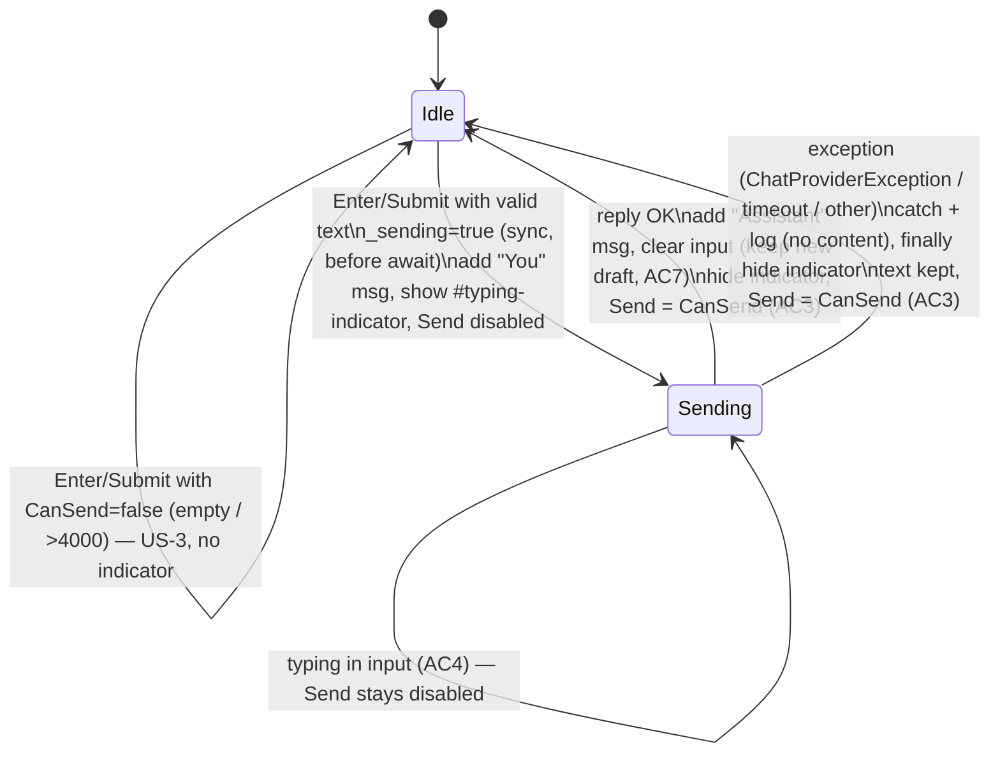

# Feature Plan: US-4 Show that the assistant is working

Status: Scaffolded — awaiting verification · Source: [US-4](../user-story/US-4-loading-indicator.md) · Date: 2026-11-04

## 1. Requirement (User Stories & Acceptance Criteria)

**US-4**: As a **visitor**, I want **to see that the assistant is working**, so that **I know to wait and don't send twice**.

AC as written in the story:

- **AC1 Typing indicator while waiting**: Given I have sent a message, while the request is in flight, then an "Assistant is typing…" indicator shows below my message.
- **AC2 No double send**: Given a request is in flight, when I click Send or press Enter, then no second request is made (Send is disabled).
- **AC3 Indicator clears when done**: Given a request is in flight, when it succeeds or fails, then the indicator is removed and Send is enabled again (if the input is valid).
- **AC4 I can keep typing while waiting**: Given a request is in flight, then the input stays editable so I can draft my next message.

**Proposed AC** (to approve):

- **AC5 Server-side guard**: Given a request is in flight, when the form is submitted anyway (for example, `disabled` removed in devtools), then no second request is made. The `disabled` attribute is cosmetic. The real guard runs in `SendAsync` on the server (Blazor Server).
- **AC6 No indicator without a send**: Given a fresh page, or a send blocked by US-3 validation, then no indicator shows.
- **AC7 Draft is kept**: Given I typed a new draft while waiting, when the reply arrives, then my draft is not wiped. Today `_text = ""` runs after the reply, so it would be (see Q1).

**Out of scope**: error messages and retry (US-6), disabling "New chat" while waiting (US-7 AC-4, which will reuse the same flag), cancelling a request in flight, streaming replies, and double-send protection on the `POST /api/chat` HTTP API.

## 2. Codebase Patterns

The story says "plain HTML + JS". The app is **Blazor Server + Radzen**, so the plan follows the real stack.

| Area | Finding | Evidence |
|---|---|---|
| Architecture | Blazor Server page injects `IChatService` directly. No HTTP call from the UI. | [Chat.razor:2](../../../Chatbot.Api/Components/Pages/Chat.razor#L2) |
| UI state | Computed properties (`Length`, `TooLong`, `CanSend`) drive the markup. The guard is re-checked inside `SendAsync`. | [Chat.razor:61-71](../../../Chatbot.Api/Components/Pages/Chat.razor#L61-L71) |
| Disabled Send | `Disabled="@(!CanSend)"` on `RadzenButton`, styled by `.send:disabled` | [Chat.razor:37](../../../Chatbot.Api/Components/Pages/Chat.razor#L37), [chat.css](../../../Chatbot.Api/wwwroot/chat.css) |
| Element ids | Tests target `#chat-input`, `#chat-form`, `#messages`, `#chat-error`, `#char-count` | [ChatPageTests.cs](../../../Chatbot.Api.Tests/Components/ChatPageTests.cs) |
| Styling | CSS variables with light and dark variants on `:root` | [chat.css:2-25](../../../Chatbot.Api/wwwroot/chat.css#L2-L25) |
| Error handling | **None in the page.** A failed send kills the Blazor circuit. The provider throws `ChatProviderException`. The HttpClient timeout (60s) throws `TaskCanceledException`, which nothing catches. | [OpenRouterChatService.cs:70](../../../Chatbot.Api/Services/OpenRouterChatService.cs#L70), [Program.cs](../../../Chatbot.Api/Program.cs) |
| Testing | bUnit `BunitContext` + `FakeChatService`. `Pending` (a `TaskCompletionSource`) holds a request in flight. `WaitForAssertion` waits for async re-renders. Names follow `US{n}_AC{n}_…` / `…_Contrast_…`. | [ChatPageTests.cs](../../../Chatbot.Api.Tests/Components/ChatPageTests.cs) |
| Docs | Each story gets a section in `chat-web-ui.md` (notes, workflow, test plan, report with mutation check) | `git show HEAD:docs/features/chat-web-ui.md` §8–9 |

## 3. Schema & Relationships

### 3.1 Existing Tables

Not touched. US-4 is page state only. `Conversations` and `Messages` are written by `ChatServiceBase` exactly as they are today.

### 3.2 Relationships (+ ER diagram)

Not applicable. No entities are involved.

### 3.3 Proposed Schema Changes

**None.** No migration.

## 4. Implementation Idea

### 4.1 Approach & Files Affected

Add `private bool _sending` to `Chat.razor`. `SendAsync` sets it **synchronously, before the first `await`**. Blazor Server serializes events on the circuit, so a second Enter or click that arrives during the await sees `_sending == true` and returns. `CanSend` becomes `Length > 0 && !TooLong && !_sending`, so the existing `Disabled` binding and the guard in `SendAsync` cover AC2 and AC5 at no extra cost. The flag is reset in a `finally` block. A `catch` logs the failure, so the circuit survives a provider error or timeout and AC3 holds on failure. The user-facing error message stays in US-6. A `<div id="typing-indicator" role="status">` is rendered **after** `<ol id="messages">`, not inside it, so the `Messages()` test helper and the message semantics stay the same. The input never gets `disabled` or `readonly` (AC4).

| File | Change |
|---|---|
| ✏️ [Chat.razor](../../../Chatbot.Api/Components/Pages/Chat.razor) | `_sending` flag, `CanSend` update, try/catch/finally, indicator markup, injected `ILogger<Chat>`, draft-preserving clear (Q1) |
| ✏️ [chat.css](../../../Chatbot.Api/wwwroot/chat.css) | `.typing` style (muted, animated dots, respects `prefers-reduced-motion`) |
| ✏️ [ChatPageTests.cs](../../../Chatbot.Api.Tests/Components/ChatPageTests.cs) | `// ---------- US-4 ----------` block of tests |
| ✏️ Docs: [US-4 story](../user-story/US-4-loading-indicator.md), [README](../user-story/README.md), `chat-web-ui.md` §10 (Q3) | Status, stack line, report |

### 4.2 Endpoints

**None.** The page calls `IChatService` in-process, and `POST /api/chat` is unchanged.

### 4.3 DTOs

**None.** `ChatRequest` and `ChatResponse` are unchanged. The UI contract that tests rely on:

| Element | When present | Meaning |
|---|---|---|
| `#typing-indicator` (`role="status"`, text "Assistant is typing…") | only while `_sending` | Tells the visitor (and screen readers) that a reply is being generated |
| `button[aria-label=Send][disabled]` | empty, too long, **or sending** | Blocks a second request |
| `#chat-input` | always enabled | Lets the visitor draft the next message |

## 5. Security Review

There is no authentication in the app, so most OWASP API items don't apply.

| # | Risk | Where | Mitigation in this plan | Test ref |
|---|---|---|---|---|
| SEC1 | Double submit or race causing duplicate LLM calls (cost) and duplicate DB rows | `SendAsync` | Server-side `_sending` guard, set before the first `await`. Not relying on the client's `disabled`. | G2, S1 |
| SEC2 | A failure leaves the UI stuck "typing" forever, or kills the circuit | `SendAsync` | `finally` resets the flag. `catch` keeps the circuit alive. Wait time is bounded by the existing 60s HttpClient timeout. | G3 |
| SEC3 | Exception details or message text leaking into logs or the UI | catch block | Log the exception and conversation id only, never the message content. Show no exception text (US-6 BR-1). | S2 |
| — | AuthN/AuthZ, BOLA, mass assignment, injection | — | N/A: no new inputs, endpoints, or auth surface. The indicator text is static. | — |

## 6. Workflow Diagram

I chose a state diagram because US-4 is a lifecycle of the page's send state.



## 7. TDD Test Plan

All tests are bUnit tests in `ChatPageTests.cs` (component level), reusing `FakeChatService.Pending`. A failure is simulated with `pending.SetException(...)`.

**Shared baseline:** render the page, type "Hello", submit with `Pending` unresolved (request in flight).

### Functional groups

#### Group 1: indicator while waiting (AC1, AC6) · component

✅ `US4_AC1_WhilePending_TypingIndicatorShown`
Given / When / Then: given the baseline, then `#typing-indicator` exists with text "Assistant is typing…" and `role="status"`, and "You: Hello" is already listed.
Demonstrates: the visitor sees right away that a reply is coming.

| ❌ | Test | Changed condition | Expected | Demonstrates |
|---|---|---|---|---|
| 1 | `US4_AC1_Contrast_FreshPage_NoIndicator` | nothing sent | no `#typing-indicator`, 0 requests | the indicator isn't shown at rest |
| 2 | `US4_AC1_Contrast_BlockedSend_NoIndicator` | text is "   " (US-3) | no indicator, 0 requests | a send blocked by validation never looks in flight |
| 3 | `US4_AC1_Contrast_IndicatorIsNotAMessage` | — | `#messages li` count = 1 (user only) | the indicator isn't mistaken for a reply |

#### Group 2: no double send (AC2) · component

✅ `US4_AC2_WhilePending_SendDisabled`: Send has the `disabled` attribute even though "Hello" is valid.

| ❌ | Test | Changed condition | Expected | Demonstrates |
|---|---|---|---|---|
| 1 | `US4_AC2_WhilePending_Enter_DoesNotSendAgain` | press Enter while pending | `Requests.Count == 1`, 1 user message | the keyboard path is blocked too |
| 2 | `US4_AC2_WhilePending_Submit_DoesNotSendAgain` | submit the form again | `Requests.Count == 1` | the click/submit path is blocked |
| 3 | `US4_AC2_WhilePending_NewValidText_StillDisabled` | type "Next" while pending | Send still disabled | valid new text doesn't unlock Send early |

#### Group 3: indicator clears when done (AC3) · component

✅ `US4_AC3_OnSuccess_IndicatorRemoved_SendReenabledWhenValid`: resolve "Hi", then type "Next": no indicator, Send enabled.
✅ (edge) `US4_AC3_OnSuccess_EmptyInput_SendStaysDisabled`. Changed: the input is empty after the reply. Demonstrates: "enabled again" still respects US-3.

| ❌ | Test | Changed condition | Expected | Demonstrates |
|---|---|---|---|---|
| 1 | `US4_AC3_OnProviderError_IndicatorRemoved_SendReenabled` | `SetException(ChatProviderException)` | `await submit` doesn't throw, no indicator, Send enabled ("Hello" kept), no assistant message | a failed reply never leaves the page stuck |
| 2 | `US4_AC3_OnTimeout_IndicatorRemoved` | `SetException(TaskCanceledException)` | same as ❌1 | an HttpClient timeout is handled too |
| 3 | `US4_AC3_AfterFailure_CanSendAgain` | after ❌1, resolve a new send | `Requests.Count == 2` | the flag is fully reset after an error |

#### Group 4: typing while waiting (AC4, AC7) · component

✅ `US4_AC4_WhilePending_InputEditable`: `#chat-input` has no `disabled`/`readonly`. Typing "Next" updates its value.

| ❌ | Test | Changed condition | Expected | Demonstrates |
|---|---|---|---|---|
| 1 | `US4_AC7_DraftTypedWhilePending_KeptAfterReply` | type "Next" while pending, then resolve | input value = "Next" | a new draft isn't wiped by the reply |
| 2 | `US4_AC7_Contrast_UnchangedText_ClearedAfterReply` | don't edit, then resolve | input = "" (existing US-1 AC-4 behavior) | the old clear-after-reply still works |

### Security groups

#### Group S1: server-side guard (AC5, SEC1) · component

✅ `US4_AC5_ForcedSubmitWhilePending_SingleRequest`: submit `#chat-form` twice back to back, without waiting for a render. Exactly 1 request, 1 user message.
Demonstrates: the `disabled` attribute isn't the only thing preventing a double charge.

#### Group S2: no leakage on failure (SEC3) · component

✅ `US4_SEC3_OnError_NoExceptionTextShown`: `SetException(new ChatProviderException("secret-detail"))`. The page markup doesn't contain "secret-detail".

### Coverage (AC → tests, Security → tests)

| AC | Tests |
|---|---|
| AC1 | G1 ✅ + ❌1–3 |
| AC2 | G2 ✅ + ❌1–3 |
| AC3 | G3 ✅ ×2 + ❌1–3 |
| AC4 | G4 ✅ |
| AC5 (proposed) | S1 |
| AC6 (proposed) | G1 ❌1–2 |
| AC7 (proposed) | G4 ❌1–2 |

| Risk | Tests |
|---|---|
| SEC1 | G2 ❌1–2, S1 |
| SEC2 | G3 ❌1–3 |
| SEC3 | S2 |

That makes 18 new tests (first draft said 19, a miscount). All 40 existing tests should stay green, including `AC4_Contrast_WhileReplyPending_InputIsKept`.

## 8. Questions & Confirmations

**Questions**

1. **Draft vs. clear-after-reply (AC4 and AC7).** Today the input keeps the sent text until the reply, then clears it. A draft typed while waiting would be wiped.
   - **(a) Recommended:** keep today's behavior, but on success clear only if the input still holds the sent text. If it was edited, keep the draft. No existing test changes, and US-6 retry stays simple.
   - **(b)** Clear the input on send, like ChatGPT. This changes the approved US-1 AC-4 behavior and its test.
2. **Failure behavior before US-6 exists.** Default: clear the indicator, log, keep the text, show **no message**. Alternative: show a placeholder "Something went wrong. Please try again." now.
3. **Working tree.** `docs/features/chat-web-ui.md` and `.claude/skills/extract-user-stories/SKILL.md` are deleted but not committed, and `feature-implementation-planner.skill` is untracked. Is that intentional? If yes, where should the US-4 report go (this plan file?).

**Assumptions to confirm** (defaults shown)

4. Add the proposed AC5–AC7 to the US-4 story. **Yes.**
5. The indicator sits **after** `#messages`, not inside it, as muted text with animated dots and `role="status"`. **Yes.**
6. The input is never disabled while waiting. Enter while waiting does nothing (no newline, no send). **Yes.**
7. Update the story's stack line from "plain HTML + JS" to Blazor Server + Radzen. **Yes.**
8. No changes to the HTTP API, services, or database. **Yes.**

## Decision log

| # | Question | Answer (2026-11-04) | Effect on plan |
|---|---|---|---|
| 1 | Draft vs. clear-after-reply | (a): on success, clear only if the input still holds the sent text | AC7 adopted. G4 tests stand. US-1 tests unchanged. |
| 2 | Failure before US-6 | Default: hide indicator, log, keep text, no message | G3 ❌1–3 and S2 stand. The error message is left to US-6. |
| 3 | Deleted docs in working tree | Intentional | `chat-web-ui.md` is not restored. This plan file holds the US-4 report. Docs in 4.1 become the US-4 story + README only. |
| 4–8 | Assumptions | Yes to all | AC5–AC7 go into the story. Indicator after `#messages`. Input never disabled. Stack line updated. No API/service/DB changes. |

---

## 9. Scaffold report

### File tree

```
Chatbot.Api/
  Components/Pages/Chat.razor            ✏️ @inject ILogger<Chat>, Sending property, indicator placeholder + TODOs
  wwwroot/chat.css                       ✏️ .typing + animated dots, prefers-reduced-motion
Chatbot.Api.Tests/
  Components/ChatPageTests.cs            ✏️ 18 US-4 test stubs (Assert.Fail)
docs/features/
  user-story/US-4-loading-indicator.md   ✏️ stack line, status, AC-5..AC-7, A-1
  user-story/README.md                   ✏️ US-4 status
  plans/US-4-loading-indicator-plan.md   🆕 this file
```

### Build and tests

- `dotnet build`: succeeded, 0 warnings, 0 errors.
- `dotnet test`: 58 total. **18 failed** (all new US-4 stubs) and **40 passed** (all existing). Nothing was skipped.

### TODO map

| TODO | Where | Covers |
|---|---|---|
| Render `#typing-indicator` while `Sending`, after `#messages` | [Chat.razor:28](../../../Chatbot.Api/Components/Pages/Chat.razor#L28) | AC1, AC6 · G1 |
| `!Sending` in `CanSend`; set before first `await` | [Chat.razor:70](../../../Chatbot.Api/Components/Pages/Chat.razor#L70) | AC2, AC5, SEC1 · G2, S1 |
| try/catch/finally, reset flag, log | [Chat.razor:71](../../../Chatbot.Api/Components/Pages/Chat.razor#L71) | AC3, SEC2 · G3 |
| Log without message text; show no exception text | [Chat.razor:72](../../../Chatbot.Api/Components/Pages/Chat.razor#L72) | SEC3 · S2 |
| Clear `_text` only if unchanged | [Chat.razor:73](../../../Chatbot.Api/Components/Pages/Chat.razor#L73) | AC7 · G4 |
| Shared baseline helper | [ChatPageTests.cs:411](../../../Chatbot.Api.Tests/Components/ChatPageTests.cs#L411) | all groups |

### Suggested first test

`US4_AC1_WhilePending_TypingIndicatorShown` (Group 1 baseline).

## 10. Verification

| # | Check | Result |
|---|---|---|
| V1 | Only planned files changed (plus this plan file) | ✅ The other diffs are `global.json` (SDK bump) and the two intentional deletions, which predate the scaffold |
| V2 | Endpoints match 4.2 | ✅ none added |
| V3 | DTOs match 4.3 | ✅ none changed. The UI contract ids are in the TODO markup. |
| V4 | Migration | ✅ none, as planned |
| V5 | Security wiring | ✅ `ILogger<Chat>` injected. The guard and catch are TODOs (they are logic). |
| V6 | Planned tests exist | ✅ planned 18 / found 18, names match §7 |
| V7 | No logic leaked | ✅ only a property, an inject, comments and CSS. No conditionals. |
| V8 | Build passes; new tests fail; existing pass | ✅ 0 warnings · 18 failed / 40 passed |

User checklist:

- ☐ File locations and names look right
- ☐ `#typing-indicator` id, text "Assistant is typing…" and its placement after `#messages` are final
- ☐ The test list is complete
- ☐ The TODO map covers all the work
