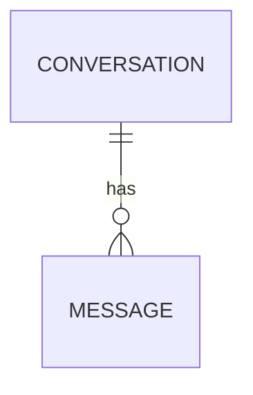
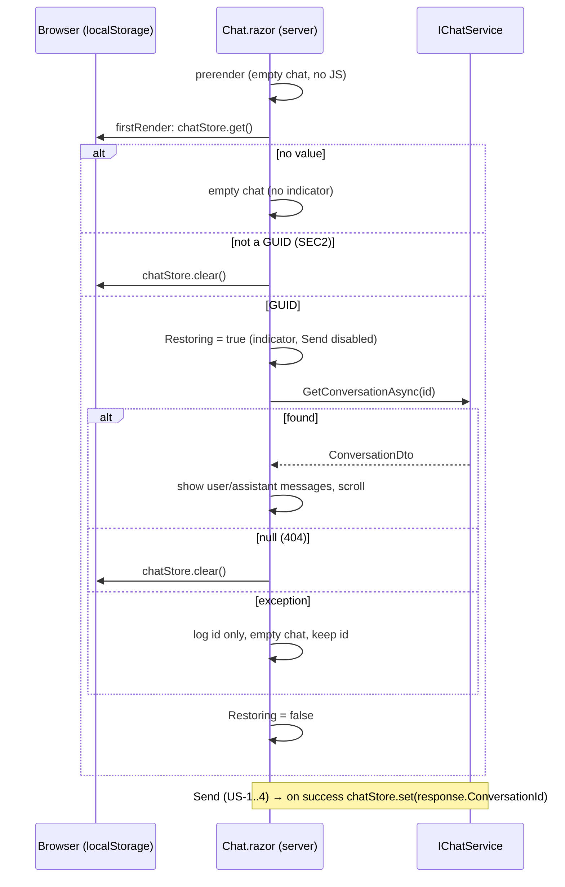

# Feature Plan: US-5 Keep the conversation after reloading

Status: Implemented — all 20 US-5 tests pass · Source: [US-5](../user-story/US-5-restore-after-reload.md) · Date: 2026-11-04

## 1. Requirement (User Stories & Acceptance Criteria)

**US-5**: As a **returning visitor**, I want **my conversation to still be there after reloading**, so that **I don't lose my chat**.

AC as written in the story:

- **AC1 Conversation id is remembered**: Given I have an active conversation, then its `conversationId` is saved in the browser's `localStorage`.
- **AC2 History reloads**: Given a saved `conversationId` exists, when I reload or reopen the page, then the page loads `GET /api/chat/{id}/messages` and shows all messages in order with the same "You" / "Assistant" styling.
- **AC3 Next message continues the restored conversation**: Given the history was restored, when I send a message, then the request uses the saved `conversationId`.
- **AC4 Missing conversation starts fresh**: Given the saved id returns 404, then the saved id is cleared, the page shows an empty chat, and no error is shown.
- **AC5 Loading state on restore**: Given history is being fetched, then a loading indicator shows and Send is disabled until it finishes.

Business rule: **BR-1** Only the `conversationId` is stored in the browser; message content always comes from the API.

**Proposed AC** (to approve):

- **AC6 Restore failure doesn't break the page**: Given restoring throws (DB error, not a 404), then the page shows an empty chat, the indicator clears, Send works, and nothing is shown to the visitor beyond what US-6 later adds. The saved id is **kept** (a transient error shouldn't lose the chat).
- **AC7 Tampered saved value**: Given `localStorage` holds a value that isn't a GUID, then no fetch is made, the value is cleared, and the page starts fresh.

**Out of scope**: "New chat" button and clearing the id from it (US-7 — will reuse the `chatStore.clear` helper from this story), error messages (US-6), syncing between tabs, storing more than one conversation / a conversation list, server-side ownership of conversations (see SEC note).

## 2. Codebase Patterns

The story assumes "plain HTML + JS". The app is **Blazor Server + Radzen**, so the plan follows the real stack (same as US-4).

| Area | Finding | Evidence |
|---|---|---|
| UI → data | Page injects `IChatService` directly; no HTTP from the UI. So AC2's `GET /api/chat/{id}/messages` maps to the **same service call** that endpoint uses: `GetConversationAsync`, which returns `null` for not-found (= 404). | [Chat.razor:2](../../../Chatbot.Api/Components/Pages/Chat.razor#L2), [ChatController.cs](../../../Chatbot.Api/Controllers/ChatController.cs), [ChatServiceBase.cs](../../../Chatbot.Api/Services/ChatServiceBase.cs) |
| History query | Already exists and orders by `CreatedAt` | [ChatServiceBase.cs](../../../Chatbot.Api/Services/ChatServiceBase.cs) `GetConversationAsync` |
| Render mode | `Routes` is `InteractiveServer` with default **prerendering**, so JS interop (`localStorage`) is only allowed in `OnAfterRenderAsync(firstRender)` | [App.razor](../../../Chatbot.Api/Components/App.razor) |
| JS helpers | Small globals in `wwwroot/chat-keys.js` (`window.chatScroll`) called via `JS.InvokeVoidAsync` | [chat-keys.js](../../../Chatbot.Api/wwwroot/chat-keys.js) |
| Busy state | `Sending` flag drives `CanSend` + indicator `role="status"`; guard re-checked in `SendAsync` | [Chat.razor](../../../Chatbot.Api/Components/Pages/Chat.razor) |
| Errors | Send catches all, logs with conversation id only (never text) | [Chat.razor](../../../Chatbot.Api/Components/Pages/Chat.razor) `SendAsync` |
| Testing | bUnit `BunitContext`, `FakeChatService`, `JSInterop.Mode = Loose`, names `US{n}_AC{n}_…` / `…_Contrast_…` | [ChatPageTests.cs](../../../Chatbot.Api.Tests/Components/ChatPageTests.cs) |
| API tests | `GET /messages` 404 and history are already covered | [ChatEndpointTests.cs](../../../Chatbot.Api.Tests/ChatEndpointTests.cs) |

## 3. Schema & Relationships

### 3.1 Existing Tables

| Table | Key columns | Constraints | Evidence |
|---|---|---|---|
| Conversations | `Id` Guid PK, `Title`, `CreatedAt` | PK | [Conversation.cs](../../../Chatbot.Api/Models/Conversation.cs) |
| Messages | `Id` Guid PK, `ConversationId` FK, `Role`, `Content`, `CreatedAt` | FK → Conversations | [Message.cs](../../../Chatbot.Api/Models/Message.cs) |

Read only.

### 3.2 Relationships (+ ER diagram)

| From | To | Cardinality | FK | Meaning |
|---|---|---|---|---|
| Conversation | Message | 1 → many | `Messages.ConversationId` | A conversation's ordered history |

Risk: history is loaded unbounded (no paging). Fine for this app; noted in Q4.

### 3.3 Proposed Schema Changes

**None.** No migration. Browser storage: one `localStorage` key `chatbot.conversationId` holding a GUID string.

## 4. Implementation Idea

### 4.1 Approach & Files Affected

Add `window.chatStore = { get, set, clear }` to `chat-keys.js` (key `chatbot.conversationId`). In `Chat.razor`, on `OnAfterRenderAsync(firstRender)` read the saved value; if it parses as a GUID, set `Restoring = true`, re-render, call `ChatService.GetConversationAsync`, and fill `_messages` from the returned messages (then scroll to bottom, reusing `_scrollPending`). `null` → `chatStore.clear` (AC4); not a GUID → clear (AC7); exception → log, keep id, show empty (AC6). `Restoring` is reset in `finally`. `CanSend` becomes `... && !Sending && !Restoring`, so the existing `Disabled` binding and `SendAsync` guard cover AC5. After a successful send, `chatStore.set` is called with the returned id (AC1, BR-1). A `#restore-indicator` `role="status"` "Loading conversation…" replaces the empty-state text while restoring.

| File | Change |
|---|---|
| ✏️ `Chatbot.Api/wwwroot/chat-keys.js` | add `window.chatStore` |
| ✏️ `Chatbot.Api/Components/Pages/Chat.razor` | `Restoring` flag, restore on first render, save after send, indicator markup |
| ✏️ `Chatbot.Api/wwwroot/chat.css` | style for `.restoring` (reuse `.typing` look) |
| ✏️ `Chatbot.Api.Tests/Components/ChatPageTests.cs` | US-5 tests; `FakeChatService` gains `Conversations` dict, `PendingConversation`, `ThrowOnGet` |
| ✏️ `docs/features/user-story/US-5-restore-after-reload.md`, `README.md` | status update after implementation |

### 4.2 Endpoints

No new endpoints. Existing `GET /api/chat/{conversationId:guid}/messages` (200 `ConversationDto` / 404 ProblemDetails) is the contract; the page calls its service method directly.

### 4.3 DTOs

No new DTOs. Uses `ConversationDto.Messages[]` → `MessageDto.Role` (shown as label/class) and `MessageDto.Content` (shown as text). `Id`, `CreatedAt`, `Title` are not rendered. Order comes from the service (`CreatedAt` asc).

Browser storage "contract":

| Key | Value | Meaning |
|---|---|---|
| `chatbot.conversationId` | GUID string | The conversation to restore; nothing else is stored (BR-1) |

## 5. Security Review

| # | Risk | Where | Mitigation | Test ref |
|---|---|---|---|---|
| SEC1 | Stored XSS via restored content | `.text` render | Razor encodes text (same as US-8 / current send path); no `MarkupString` | S1 |
| SEC2 | Tampered `localStorage` value | `chatStore.get` | `Guid.TryParse`; anything else → clear, no service call | G2❌2 |
| SEC3 | Message text in browser storage (shared machine) | `chatStore.set` | BR-1: only the id is stored | G1❌3 |
| SEC4 | Logging | restore failure | Log conversation id only, never content (matches SendAsync) | G6 |
| SEC5 | BOLA: anyone with the GUID can read the conversation | existing API | **Pre-existing**, app has no auth; GUIDs are unguessable (122 bits). Accepted as a known limitation (D3) | — |
| — | Rate limit / brute force | — | N/A for this story (no new endpoint) | — |

## 6. Workflow Diagram

Sequence diagram, because the feature is an ordering of browser storage, page and service calls with branches.

## 7. TDD Test Plan

All bUnit tests in `ChatPageTests.cs`. `chatStore.get` is set up with `JSInterop.Setup<string?>("chatStore.get")`; `set`/`clear` verified with `JSInterop.VerifyInvoke`.

### Functional groups

**Group 1 — Id is saved (AC1, BR-1)** · Baseline: fresh page, one successful send.

✅ `US5_AC1_AfterReply_IdIsSaved` — `chatStore.set` called with the returned id. Demonstrates: a reload can find the conversation.
✅ (edge) `US5_AC1_FollowUp_SavesLatestId` — Changed: second reply returns a different id. Demonstrates: the stored id follows US-2 BR-1.

| ❌ | Test | Changed | Expected | Demonstrates |
|---|---|---|---|---|
| 1 | `US5_AC1_Contrast_FailedSend_NothingSaved` | send throws | no `chatStore.set` | a failed first send doesn't save a ghost id |
| 2 | `US5_AC1_Contrast_FreshPage_NothingSaved` | no send | no `chatStore.set` | |
| 3 | `US5_BR1_OnlyIdIsStored` | — | `set` is called with exactly one GUID string arg | no message text in the browser |

**Group 2 — History reloads (AC2, AC7)** · Baseline: saved id exists, service has 2 user + 2 assistant messages.

✅ `US5_AC2_SavedId_ShowsHistoryInOrderWithLabels`
✅ (edge) `US5_AC2_RestoredHistory_ScrollsToLatest`

| ❌ | Test | Changed | Expected | Demonstrates |
|---|---|---|---|---|
| 1 | `US5_AC2_Contrast_NoSavedId_NoFetch` | get returns null | no service call, empty state | |
| 2 | `US5_AC7_InvalidSavedId_NoFetch_Cleared` | get returns `"abc"` | no service call, `clear` called | tampered storage is harmless |
| 3 | `US5_AC2_Contrast_EmptyHistory_ShowsEmptyState` | conversation has 0 messages | empty-state text, id kept | |

**Group 3 — Next send continues (AC3)** · Baseline: restored conversation, then send.

✅ `US5_AC3_AfterRestore_SendUsesSavedId`

| ❌ | Test | Changed | Expected | Demonstrates |
|---|---|---|---|---|
| 1 | `US5_AC3_Contrast_NotFound_SendHasNoId` | saved id not found | request `ConversationId == null` | a dead id is never reused |

**Group 4 — Missing conversation (AC4)** · Baseline: saved id, service returns null.

✅ `US5_AC4_NotFound_ClearsId_EmptyChat_NoError` — `clear` called, empty state, no `#chat-error`.

| ❌ | Test | Changed | Expected | Demonstrates |
|---|---|---|---|---|
| 1 | `US5_AC4_Contrast_Found_IdNotCleared` | found | no `clear` | only a 404 clears |

**Group 5 — Loading state (AC5)** · Baseline: saved id, `PendingConversation` not completed.

✅ `US5_AC5_WhileRestoring_IndicatorShown_SendDisabled`
✅ `US5_AC5_AfterRestore_IndicatorCleared_SendEnabled`

| ❌ | Test | Changed | Expected | Demonstrates |
|---|---|---|---|---|
| 1 | `US5_AC5_WhileRestoring_EnterAndSubmit_DoNotSend` | type + Enter/submit while pending | 0 requests | server-side guard, not just `disabled` |
| 2 | `US5_AC5_Contrast_NoSavedId_NoIndicator` | no saved id | no `#restore-indicator` | |

**Group 6 — Restore failure (AC6)** · Baseline: saved id, service throws.

✅ `US5_AC6_RestoreThrows_EmptyChat_IndicatorCleared_SendWorks` — also asserts `clear` not called.

### Security groups

**Group S1 — Encoding (SEC1)**: ✅ `US5_SEC1_RestoredHtml_RenderedAsText` — content `<b>x</b>` appears as text, no `<b>` element.

### Coverage (AC → tests, Security → tests)

| AC | Tests |
|---|---|
| AC1 / BR-1 | G1 (5) |
| AC2 | G2 baseline, edge, ❌1, ❌3 |
| AC3 | G3 (2) |
| AC4 | G4 (2), G3❌1 |
| AC5 | G5 (4) |
| AC6 | G6 (1) |
| AC7 | G2❌2 |

| Risk | Tests |
|---|---|
| SEC1 | S1 |
| SEC2 | G2❌2 |
| SEC3 | G1❌3 |
| SEC4 | G6 (no content logged — by review) |
| SEC5 | none — accepted known limitation (D3) |

**Total: 20 new tests.**

## 8. Questions & Confirmations

**Questions**

1. Approve proposed AC6–AC8?
2. On a non-404 restore failure (AC6): keep the saved id (my default) or clear it? Keeping means a later reload can still recover; but if the user sends meanwhile, the message continues the hidden conversation. Alternative: keep the id but send as a new conversation until a restore succeeds.
3. SEC5: accept that a conversation GUID is the only "key" (no user accounts)? I'll leave it as-is and note it in the story.
4. Very long histories are loaded fully. OK for now (no paging)?

**Assumptions to confirm** (defaults)

5. Follow Blazor Server reality: AC2 "calls GET /api/chat/{id}/messages" is satisfied by calling the same `GetConversationAsync` the endpoint uses — **yes**.
6. Storage key name `chatbot.conversationId` — **yes**.
7. Indicator text "Loading conversation…", shown in place of "How can I help you today?" — **yes**.
8. Helpers live in existing `chat-keys.js` rather than a new JS file — **yes**.
9. Story is "Should" with no points; size looks small (~3), no split needed.

No files or data were changed other than this plan file.

## Decision log

| # | Question | Answer | Change in plan |
|---|---|---|---|
| D1 | Approve proposed AC6–AC8? | AC6 + AC7 only | AC8 and `US5_AC8_SystemMessages_NotShown` removed; restore shows all returned messages (no role filter — `system` is never stored). 20 tests. |
| D2 | Non-404 restore failure: keep or clear the saved id? | Keep | AC6 as written; G6 asserts `clear` is not called |
| D3 | GUID as the only access key (SEC5) | Leave as-is, note it | Note added to the US-5 story when implemented; no test |
| D4 | Full history, no paging; defaults (key `chatbot.conversationId`, "Loading conversation…", helper in `chat-keys.js`) | Yes, all defaults | none |

## 9–10. Scaffold report & verification

See [US-5-scaffold-report.md](US-5-scaffold-report.md).
