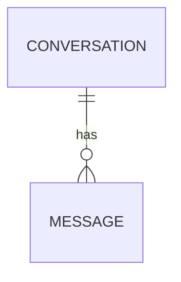
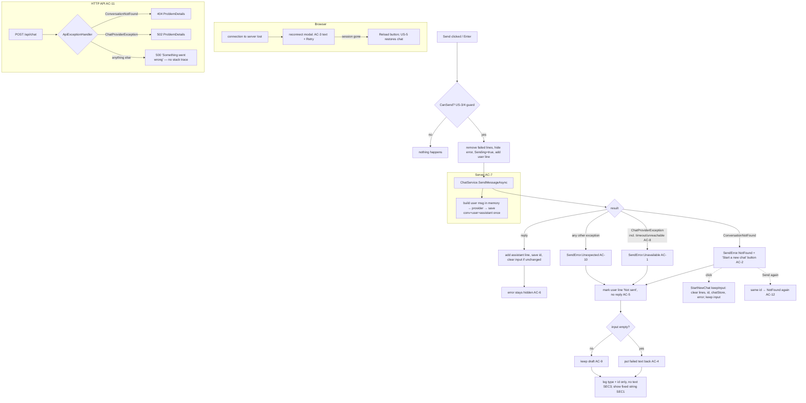

# Feature Plan: US-6 Clear feedback on failure

Status: All questions answered (2026-11-05) — awaiting go-ahead to scaffold · Source: [US-6](../user-story/US-6-error-feedback.md) · Date: 2026-11-04

## 1. Requirement (User Stories & Acceptance Criteria)

**US-6**: As a **visitor**, I want **clear feedback when something fails**, so that **I can retry without retyping**.

AC as written in the story (numbers kept):

- **AC-1 Assistant unavailable (502)**: Given the API returns 502, then an error shows "The assistant is unavailable right now. Please try again."
- **AC-2 Conversation not found (404)**: Given I send with a `conversationId` and the API returns 404, then an error says the conversation no longer exists and offers to start a new chat (US-7).
- **AC-3 Network failure**: Given the API cannot be reached, then an error shows "Can't reach the server. Check your connection and try again."
- **AC-4 Text is kept for retry**: Given any send fails, then my message text is back in the input (or a Retry button resends it), so I don't retype it.
- **AC-5 Failed message is not shown as delivered**: Given a send fails, then no assistant reply is added and my message is marked as not sent.
- **AC-6 Error clears on success**: Given an error is showing, when the next send succeeds, then the error is removed.

Business rule: **BR-1** Raw server errors or stack traces are never shown to the visitor.

**What the ACs mean on the real stack.** The story assumes plain HTML + JS calling the HTTP API. The app is **Blazor Server**: the page calls `IChatService` directly on the server, and the browser talks to the server over a live SignalR connection (the "circuit"). So:

| Story says | Real equivalent |
|---|---|
| API returns 502 | `IChatService.SendMessageAsync` throws `ChatProviderException` (the controller maps that same exception to 502) |
| API returns 404 | `SendMessageAsync` throws `ConversationNotFoundException` (controller maps it to 404) |
| API cannot be reached | The browser loses its connection to our server. Clicks never reach the page code; Blazor shows its **reconnect UI** instead. AC-3 is met by customizing that UI. |

**Added AC** (confirmed 2026-11-05, see §8):

- **AC-7 A failed send isn't saved** *(Q1)*: Given a send fails, then the server has not stored my message (or a new empty conversation), so a reload (US-5) doesn't show it as delivered and a retry doesn't store it twice.
- **AC-8 Provider timeouts and outages count as "unavailable"** *(Q2)*: Given the AI provider times out, can't be reached, or returns unreadable data, then the visitor sees the AC-1 message (and the HTTP API returns 502 instead of 500).
- **AC-9 A draft is never overwritten** *(Q4)*: Given I typed new text while the reply was pending and the send fails, then my new text stays in the input; the failed text is still visible in the "not sent" message.
- **AC-10 Unknown errors get a general message** *(Q7)*: Given a send fails for any other reason (e.g. the database is down), then the error shows "Something went wrong. Please try again."
- **AC-11 The HTTP API always answers with a safe error** *(Q2)*: Given any error happens while handling `/api/*`, then the response is ProblemDetails JSON from one global handler: 404 conversation not found, 502 provider error, 500 anything else with detail "Something went wrong. Please try again." It never contains exception text or a stack trace, also in Development.
- **AC-12 Sending again after "not found" keeps the old id** *(Q6)*: Given the "conversation no longer exists" error is showing, when I press Send instead of "Start a new chat", then the message goes to the same conversation id and the same error shows again (the page never switches conversation without the visitor seeing it).

**Out of scope**: the "New chat" header button and its "disabled while waiting" rule (US-7 — US-6 only adds `StartNewChat()` and the button inside the 404 error, Q11), automatic retries, a per-message Retry button (Q4 = option a), keeping unsent text across a full page reload (US-5 BR-1 forbids storing text in the browser), rate limiting, and changing the 400 validation error body.

## 2. Codebase Patterns

| Area | Finding | Evidence |
|---|---|---|
| UI → data | Page injects `IChatService` and calls it directly; no HTTP from the UI | [Chat.razor:2](../../../Chatbot.Api/Components/Pages/Chat.razor#L2) |
| Send flow | `Sending` set before the first await; user message added before the call; `_text` cleared only on success (so it's already kept on failure); `catch (Exception)` logs and shows nothing | [Chat.razor:95-128](../../../Chatbot.Api/Components/Pages/Chat.razor#L95-L128) |
| Message model in the page | `private sealed record ChatLine(string Role, string Text)`, rendered as `<li class="message @Role">` | [Chat.razor:224](../../../Chatbot.Api/Components/Pages/Chat.razor#L224) |
| Existing error UI | Only US-3's length error: `<p id="chat-error" class="hint-error" role="alert">` in the composer footer. US-5 tests assert `#chat-error` is absent on restore 404, so US-6 needs its **own id** | [Chat.razor:51](../../../Chatbot.Api/Components/Pages/Chat.razor#L51), [ChatPageTests.cs](../../../Chatbot.Api.Tests/Components/ChatPageTests.cs) `US5_AC4_NotFound_ClearsId_EmptyChat_NoError` |
| Exceptions | `ConversationNotFoundException(Guid)` (message contains the id), `ChatProviderException(string)` (fixed, safe messages) | [ChatExceptions.cs](../../../Chatbot.Api/Services/ChatExceptions.cs) |
| Controller mapping | NotFound → 404 ProblemDetails, ChatProviderException → 502, both in a try/catch inside the action. Anything else (e.g. `HttpRequestException`, timeout `TaskCanceledException`) is **unhandled → 500** | [ChatController.cs](../../../Chatbot.Api/Controllers/ChatController.cs) |
| Global error handling | None: no `AddProblemDetails`, `AddExceptionHandler` or `UseExceptionHandler`. In Development the built-in developer exception page answers unhandled API errors with a stack trace. .NET 10 | [Program.cs](../../../Chatbot.Api/Program.cs) |
| API test doubles | `ChatbotApiFactory` swaps in `MockChatService` (never fails); no test covers the 502 path today | [ChatbotApiFactory.cs](../../../Chatbot.Api.Tests/ChatbotApiFactory.cs) |
| Provider | Only non-2xx and empty content are wrapped in `ChatProviderException`. `httpClient.SendAsync` network errors, the 60s timeout, and bad JSON escape unwrapped | [OpenRouterChatService.cs:60-81](../../../Chatbot.Api/Services/OpenRouterChatService.cs#L60-L81), [Program.cs:56](../../../Chatbot.Api/Program.cs#L56) |
| Persistence order | The user message (and a new conversation) is **saved before** the provider is called; the assistant message is saved after. A failed reply leaves the user message in the DB | [ChatServiceBase.cs:27-55](../../../Chatbot.Api/Services/ChatServiceBase.cs#L27-L55) |
| DbContext lifetime | Scoped. In Blazor Server a scope lives as long as the circuit, so the page's service and `DbContext` live for the whole visit. Unsaved tracked entities from a failed call would be saved by the **next** successful call | [Program.cs:39](../../../Chatbot.Api/Program.cs#L39) |
| Reconnect UI | None customized; App.razor uses the default from `blazor.web.js` | [App.razor](../../../Chatbot.Api/Components/App.razor) |
| JS helpers | Small globals in `chat-keys.js` (`chatScroll`, `chatStore`) | [chat-keys.js](../../../Chatbot.Api/wwwroot/chat-keys.js) |
| Styling | CSS variables incl. `--chat-error`; `.hint-error`, `.typing` | [chat.css](../../../Chatbot.Api/wwwroot/chat.css) |
| Tests | bUnit `BunitContext` + `FakeChatService` (`Pending` task can be faulted), `JSInterop.Mode = Loose`; names `US{n}_AC{n}_…` / `…_Contrast_…`. Service tests use in-memory SQLite + `StubHttpMessageHandler`. API tests use `ChatbotApiFactory` | [ChatPageTests.cs](../../../Chatbot.Api.Tests/Components/ChatPageTests.cs), [OpenRouterChatServiceTests.cs](../../../Chatbot.Api.Tests/OpenRouterChatServiceTests.cs), [ChatEndpointTests.cs](../../../Chatbot.Api.Tests/ChatEndpointTests.cs) |
| Logging rule | Log the conversation id only, never message text (US-4 SEC3, US-5 SEC4) | [Chat.razor:119-123](../../../Chatbot.Api/Components/Pages/Chat.razor#L119-L123) |

## 3. Schema & Relationships

### 3.1 Existing Tables

| Table | Key columns | Constraints | Evidence |
|---|---|---|---|
| Conversations | `Id` Guid PK, `Title` string, `CreatedAt` DateTime | PK | [Conversation.cs](../../../Chatbot.Api/Models/Conversation.cs) |
| Messages | `Id` Guid PK, `ConversationId` FK, `Role` string, `Content` string, `CreatedAt` DateTime (set at construction) | FK → Conversations | [Message.cs](../../../Chatbot.Api/Models/Message.cs) |

### 3.2 Relationships (+ ER diagram)

| From | To | Cardinality | FK | Meaning |
|---|---|---|---|---|
| Conversation | Message | 1 → many | `Messages.ConversationId` | A conversation's ordered history |



Risk relevant to US-6: today a failed reply leaves a user message with no answer, and for a first message an empty conversation whose id the visitor never receives. Retrying stores the user message twice and sends two identical user turns to the model.

### 3.3 Proposed Schema Changes

**None.** No migration. AC-7 changes only *when* rows are written: the conversation (if new), the user message and the assistant message are saved together in one `SaveChangesAsync` after the reply arrives. `Message.CreatedAt` is set when the object is built, so the user message still sorts before the reply.

## 4. Implementation Idea

### 4.1 Approach & Files Affected

**Page.** `ChatLine` gets a `Failed` flag. `SendAsync` first drops any earlier failed lines (they are being resent or replaced) and hides the error, then works as today. The single `catch` becomes three: `ConversationNotFoundException` → `SendError.NotFound`; `ChatProviderException` → `SendError.Unavailable`; any other exception → `SendError.Unexpected` (Q7, AC-10). The page keeps its own catch because Blazor events run over the circuit, not the HTTP pipeline, so the global API handler never sees them. After a 404 the conversation id is **kept**; a plain resend goes to the same id and fails the same way (Q6, AC-12). On failure the last user line is marked `Failed` (rendered `class="message user failed"` with a "Not sent" tag), no assistant line is added, and if the input is empty the failed text is put back (AC-4); a different draft is kept (AC-9). The error is shown **as a message in the chat** (Q10): `<li id="send-error" class="message error" role="alert">` rendered right after the failed user message, on the left where the reply would have appeared, with a red background. It is driven by `SendError` state and rendered after the `foreach`, **not stored in `_messages`**, so it never looks like an assistant reply (no `assistant` class, no "Assistant" label) and existing `li.assistant` tests are unaffected. A failure sets the scroll flag so the error bubble is scrolled into view. It shows **only fixed strings** from a small lookup, never `ex.Message` (BR-1). For `NotFound` it contains a `#send-error-new-chat` button that calls a new `StartNewChat(bool keepInput)` with `keepInput: true`: clear messages, conversation id, saved id (`chatStore.clear`) and the error, keep the input text, focus the input (Q11). US-7 will reuse it for its header button with `keepInput: false` (US-7 AC-1 empties the input) and add its own "disabled while waiting" rule.

**Server — save order.** `ChatServiceBase.SendMessageAsync` builds the user message in memory, passes `saved history + new message` to `GenerateReplyAsync`, and only then adds the conversation (if new), user and assistant messages and saves once (AC-7, Q1). Nothing is tracked before the reply, so a failure can't leak rows into the next save.

**Server — classify provider errors.** `OpenRouterChatService` wraps `HttpRequestException`, a timeout `TaskCanceledException` (when the caller's token was *not* cancelled), and `JsonException` in `ChatProviderException` with fixed messages (AC-8); a real caller cancellation still propagates. This stays even with the global handler: it is the one place that decides "provider down" vs "unknown", which both the page (AC-1 vs AC-10 text) and the API (502 vs 500) rely on. Fixed messages: "The chat provider could not be reached." / "The chat provider did not respond in time." / "The chat provider returned an unreadable response."

**Server — global API handler (Q2, AC-11).** New `ApiExceptionHandler : IExceptionHandler` writes every `/api/*` error through `IProblemDetailsService`: `ConversationNotFoundException` → 404 "Conversation not found" (detail = `ex.Message`, as today); `ChatProviderException` → 502 "Chat provider error" (detail = its fixed message, logged as warning); anything else → 500 "Unexpected error" with detail "Something went wrong. Please try again." (logged as error, `ex.Message` never written). Program.cs: `AddProblemDetails()`, `AddExceptionHandler<ApiExceptionHandler>()`, and `app.UseWhen(c => c.Request.Path.StartsWithSegments("/api"), b => b.UseExceptionHandler())` registered before `MapControllers`. Scoping to `/api` keeps the Blazor page's own error behavior unchanged; in Development the inner handler catches API errors before the developer exception page. A request the client aborted is left to the built-in middleware (it skips handlers and returns 499; verify in scaffold). The try/catch in `ChatController.SendMessage` is removed; the action gets `[ProducesResponseType<ProblemDetails>(500)]`.

**Connection loss (AC-3).** App.razor gets a custom `<div id="components-reconnect-modal">`. Blazor finds it by id and toggles classes on it (`components-reconnect-show` / `-retrying` / `-failed` / `-rejected`); CSS shows the right part. Text: "Can't reach the server. Check your connection and try again." with a **Retry** button (`Blazor.reconnect()`, falls back to reload), and for `-rejected` (server restarted, session gone) "The page needs to reload." with a **Reload** button. Helpers go in `chat-keys.js` as `window.chatReconnect`. While disconnected the textarea keeps its text in the browser, so AC-4 holds; after a reload US-5 restores the conversation but the unsent text is lost (stated as a known limit).

| File | Change |
|---|---|
| ✏️ `Chatbot.Api/Components/Pages/Chat.razor` | `SendError` state + text lookup, `ChatLine.Failed`, error message bubble + new-chat button, "Not sent" tag, split catch, `StartNewChat()` |
| ✏️ `Chatbot.Api/Components/App.razor` | custom reconnect modal markup |
| ✏️ `Chatbot.Api/wwwroot/chat-keys.js` | `window.chatReconnect = { retry, reload }` |
| ✏️ `Chatbot.Api/wwwroot/chat.css` | `.message.error` bubble with new `--chat-error-bg` / `--chat-error-fg` variables (light: `#d93025` / `#ffffff`, 4.8:1; dark: `#f28b82` / `#212121`, ≈6.8:1, both pass WCAG AA), `.message.user.failed` + `.not-sent` tag, reconnect modal states |
| ✏️ `Chatbot.Api/Services/ChatServiceBase.cs` | save the turn only after the reply (AC-7) |
| ✏️ `Chatbot.Api/Services/OpenRouterChatService.cs` | wrap network / timeout / bad JSON in `ChatProviderException` (AC-8) |
| 🆕 `Chatbot.Api/Infrastructure/ApiExceptionHandler.cs` | global `/api` exception → ProblemDetails mapping (AC-11) |
| ✏️ `Chatbot.Api/Program.cs` | register ProblemDetails + handler, `UseWhen("/api") → UseExceptionHandler()` |
| ✏️ `Chatbot.Api/Controllers/ChatController.cs` | remove try/catch from `SendMessage`, add 500 response type |
| ✏️ `Chatbot.Api.Tests/Components/ChatPageTests.cs` | US-6 page tests (`FakeChatService` unchanged — `Pending` can already be faulted) |
| ✏️ `Chatbot.Api.Tests/OpenRouterChatServiceTests.cs` | AC-7 / AC-8 service tests |
| ✏️ `Chatbot.Api.Tests/ChatEndpointTests.cs` | AC-3 page markup test, AC-11 API error tests + a small `ThrowingChatService` swapped in via `WithWebHostBuilder` |
| ✏️ `docs/features/user-story/US-6-error-feedback.md`, `README.md` | stack line, confirmed ACs, status (after implementation) |

### 4.2 Endpoints

No new endpoints. Existing contract changes from AC-8 and AC-11:

| Method | URL | Purpose | Success | Errors |
|---|---|---|---|---|
| POST | `/api/chat` | send a message | 200 `ChatResponse` | 400 validation (unchanged), 404 conversation not found, **502 now also for provider timeout / unreachable / bad JSON** (was 500), **500 any other error as ProblemDetails** with a fixed detail (was an empty 500, or a stack-trace page in Development) |
| GET | `/api/chat/{id}/messages` | read history | 200 `ConversationDto` | 404 (unchanged), **500 as ProblemDetails** via the same handler |

Example 500 body (`application/problem+json`):

```json
{
  "type": "https://tools.ietf.org/html/rfc9110#section-15.6.1",
  "title": "Unexpected error",
  "status": 500,
  "detail": "Something went wrong. Please try again.",
  "traceId": "00-…"
}
```

No new URL or method, so no versioning question. Every `detail` is a fixed, safe string.

### 4.3 DTOs

No new or changed DTOs. Page-only state (not part of any API):

| Name | Type | Meaning |
|---|---|---|
| `SendError` | enum `None`, `Unavailable`, `NotFound`, `Unexpected` | Which error message the chat shows. Only this enum reaches the markup, never exception text (BR-1) |
| `ChatLine.Failed` | bool | The user's message wasn't delivered; renders the "Not sent" tag (AC-5) |

Visible strings:

| Key | Text |
|---|---|
| Unavailable (AC-1) | The assistant is unavailable right now. Please try again. |
| NotFound (AC-2) | This conversation no longer exists. + button "Start a new chat" |
| Unexpected (AC-10) | Something went wrong. Please try again. |
| Connection lost (AC-3) | Can't reach the server. Check your connection and try again. + "Retry" |
| Session gone (AC-3 edge) | The page needs to reload. + "Reload" |
| Failed tag (AC-5) | Not sent |

## 5. Security Review

| # | Risk | Where | Mitigation in this plan | Test ref |
|---|---|---|---|---|
| SEC1 | Exception text / stack trace shown to the visitor (BR-1). `ConversationNotFoundException.Message` contains the GUID; provider bodies can contain account info | error message bubble | The bubble renders a fixed string chosen from `SendError`; `ex.Message` is never used in markup | S1 (2) + existing `US4_SEC3_OnError_NoExceptionTextShown` |
| SEC2 | Unhandled API error returns a stack trace (developer exception page in Development) or exception text (OWASP API8 security misconfiguration) | `/api/*` | AC-8 wraps provider errors → 502; AC-11 global handler turns everything else into a 500 ProblemDetails with a fixed detail, in every environment | G7 (4), G9 (5) |
| SEC3 | Message text written to logs on failure | `SendAsync` catch blocks | Log type + conversation id only (existing rule). Provider keeps logging the truncated provider body server-side (unchanged) | review |
| SEC4 | Failed turn rows saved by a later successful call (scoped DbContext lives for the circuit) | `ChatServiceBase` | Don't add anything to the context before the reply arrives | G6✅3 |
| SEC5 | Double send via retry | Send / new-chat button | Reuses the US-4 `Sending` guard; new-chat only resets state | existing US-4 S1 |
| SEC6 | XSS through error text | error message bubble | Constant strings, Razor-encoded | covered by SEC1 |
| SEC7 | Unsent text kept in browser storage across reloads | — | Not done (US-5 BR-1) | — |
| SEC8 | Global handler also catching page requests (turns Blazor errors into JSON, hides problems during development) | Program.cs | Handler is mounted only for `/api` with `UseWhen` | review |
| — | AuthN/AuthZ, BOLA, mass assignment, rate limiting | — | Not applicable: no new endpoint, no new input field. Pre-existing "GUID is the only key" stays as accepted in US-5 D3 | — |

## 6. Workflow Diagram

Flowchart, because US-6 is mostly a decision on how a send ends.



## 7. TDD Test Plan

Page tests are bUnit tests in `ChatPageTests.cs`. Shared baseline: `_chat.Pending = Task.FromException<string>(ex)`, render, `SendAsync(page, "Hello")`. Helper `Fail(Exception)` sets this up. Strings asserted exactly.

### Functional groups

### Group 1 — Right message per failure (AC-1, AC-10) · component
Baseline: Given a fresh page and `ChatProviderException("boom")` from the service · When send "Hello"

| # | Type | Test name | Changed condition (vs baseline) | Expected result (Then) | Demonstrates |
|---|---|---|---|---|---|
| ✅1 | baseline | `US6_AC1_ProviderError_ShowsUnavailableMessage` | — | `#send-error` shows the AC-1 text, `role="alert"` | A provider failure gets a clear message |
| ✅2 | edge | `US6_AC10_UnexpectedError_ShowsSomethingWentWrong` | `InvalidOperationException("db down")` | `#send-error` shows "Something went wrong. Please try again." (not the AC-1 text) | Unknown errors get the general message (Q7) |
| ❌1 | negative | `US6_AC1_Contrast_Success_NoError` | send succeeds | no `#send-error` | The error message only appears on failure |
| ❌2 | negative | `US6_AC1_Contrast_TooLong_NoSendError` | 4001 chars, try to send | `#chat-error` shown, no `#send-error`, 0 requests | Validation (US-3) and send errors stay separate |
| ❌3 | negative | `US6_AC2_Contrast_ProviderError_NoNewChatButton` | — (provider error, check the button) | no `#send-error-new-chat` | "Start a new chat" is only offered when the conversation is gone |

### Group 2 — Conversation gone (AC-2) · component
Baseline: Given an active conversation `Abc` and `ConversationNotFoundException(Abc)` from the service · When send "Hello"

| # | Type | Test name | Changed condition (vs baseline) | Expected result (Then) | Demonstrates |
|---|---|---|---|---|---|
| ✅1 | baseline | `US6_AC2_NotFound_ShowsGoneMessageAndNewChatButton` | — | text "This conversation no longer exists.", `#send-error-new-chat` present | The visitor learns why and what to do |
| ✅2 | edge | `US6_AC2_NewChat_ClearsChatErrorAndId_KeepsText` | then click `#send-error-new-chat`, then send | no `#messages li`, no `#send-error`, `chatStore.clear` once, input still "Hello", focus called; next request `ConversationId == null` | The visitor can carry on in a fresh chat without retyping |
| ❌1 | negative | `US6_AC12_SendAgainWithoutNewChat_SameIdSameError` | press Send again instead of the button (still 404) | second request `ConversationId == Abc`, error message shows the NotFound text, `chatStore.clear` not called | The page never switches conversation on its own (Q6) |

### Group 3 — Text kept for retry (AC-4, AC-9) · component
Baseline: Given a fresh page and a failing service · When send "Hello"

| # | Type | Test name | Changed condition (vs baseline) | Expected result (Then) | Demonstrates |
|---|---|---|---|---|---|
| ✅1 | baseline | `US6_AC4_Failure_TextStaysInInput` | — | input value "Hello" | No retyping after a failure |
| ✅2 | edge | `US6_AC4_InputClearedWhileWaiting_FailedTextRestored` | input set to "" while pending | input becomes "Hello" | The failed text comes back even if the box was emptied |
| ✅3 | edge | `US6_AC9_DraftTypedWhileWaiting_DraftKept` | "Next" typed while pending | input stays "Next"; failed bubble still shows "Hello" | A new draft is never overwritten |
| ✅4 | edge | `US6_AC4_Resend_SendsSameText` | submit again after the failure | second request message "Hello", same `ConversationId` as the first | Retrying is one click and goes to the same conversation |

### Group 4 — Not shown as delivered, error in the chat (AC-5, Q10) · component
Baseline: Given a fresh page and a failing service · When send "Hello"

| # | Type | Test name | Changed condition (vs baseline) | Expected result (Then) | Demonstrates |
|---|---|---|---|---|---|
| ✅1 | baseline | `US6_AC5_Failure_MessageMarkedNotSent_NoReply` | — | single `li.user.failed`, `.not-sent` = "Not sent", no `li.assistant` | A failed message never looks delivered |
| ✅2 | edge | `US6_AC5_Resend_ReplacesFailedMessage` | resend succeeds | messages `["Hello", "Hi"]`, no `.failed` | The screen ends up matching what the server stored |
| ✅3 | edge | `US6_AC5_ErrorMessage_FollowsFailedMessage` | — (check order) | `#messages li` = `[li.user.failed, li#send-error.message.error]`; error `li` has no `.assistant` class and no "Assistant" label | The error appears in the chat, right after the message that failed (Q10) |
| ✅4 | edge | `US6_AC5_Failure_ScrollsToError` | — | `chatScroll.toBottom` called after the failure render | The error isn't hidden below the fold |
| ❌1 | negative | `US6_AC5_Contrast_Success_MessageNotMarked` | send succeeds | no `.failed`, no `.not-sent` | Only failed messages are marked |

### Group 5 — Error clears (AC-6) · component
Baseline: Given a send of "Hello" failed and the error is showing · When send again and it succeeds

| # | Type | Test name | Changed condition (vs baseline) | Expected result (Then) | Demonstrates |
|---|---|---|---|---|---|
| ✅1 | baseline | `US6_AC6_NextSendSucceeds_ErrorRemoved` | — | no `#send-error` | A success removes a stale error |
| ✅2 | edge | `US6_AC6_WhileRetryPending_ErrorHidden` | retry still in flight | no `#send-error`, typing indicator shown | The old error doesn't sit next to "Assistant is typing" |
| ❌1 | negative | `US6_AC6_Contrast_SecondFailure_ErrorShownAgain` | retry fails with `ConversationNotFoundException` | error message shows the NotFound text, not the old one | The error always reflects the latest failure |
| ❌2 | negative | `US6_AC6_Contrast_TypingAlone_DoesNotClearError` | only type "x", no send | error message still shown | Typing isn't a success |

### Group 6 — Failed send isn't saved (AC-7, SEC4) · service (`OpenRouterChatServiceTests`, in-memory SQLite)
Baseline: Given the provider stub returns 500 · When `SendMessageAsync` for a new conversation

| # | Type | Test name | Changed condition (vs baseline) | Expected result (Then) | Demonstrates |
|---|---|---|---|---|---|
| ✅1 | baseline | `US6_AC7_ProviderFails_NewConversation_NothingSaved` | — | `ChatProviderException`; 0 conversations, 0 messages | A failed first message leaves no orphan conversation |
| ✅2 | edge | `US6_AC7_ProviderFails_ExistingConversation_HistoryUnchanged` | seeded conversation with 2 messages | still 2 messages | A failed follow-up doesn't add a half turn |
| ✅3 | edge | `US6_AC7_RetryAfterFailure_SavesOneUserMessage` | same service + context: fail, then provider returns 200 | exactly 1 user + 1 assistant message | Rows from a failed attempt never leak into the next save |
| ✅4 | edge | `US6_AC7_Success_SendsNewMessageToProvider` | provider returns 200 | captured request body ends with the new user message | Building history in memory still sends the latest message |

### Group 7 — Provider errors become "unavailable" (AC-8, SEC2) · service
Baseline: Given the stub handler throws `HttpRequestException` · When `SendMessageAsync`

| # | Type | Test name | Changed condition (vs baseline) | Expected result (Then) | Demonstrates |
|---|---|---|---|---|---|
| ✅1 | baseline | `US6_AC8_ProviderUnreachable_ThrowsChatProviderException` | — | `ChatProviderException` (API: 502) | An outage is reported as "unavailable", not a 500 |
| ✅2 | edge | `US6_AC8_ProviderTimeout_ThrowsChatProviderException` | handler throws `TaskCanceledException`, caller token not cancelled | `ChatProviderException` | The 60s timeout is treated as an outage |
| ✅3 | edge | `US6_AC8_ProviderInvalidJson_ThrowsChatProviderException` | 200 with body `not json` | `ChatProviderException` | Garbage from the provider is an outage, not a crash |
| ❌1 | negative | `US6_AC8_Contrast_CallerCancelled_NotWrapped` | caller's token is cancelled | `OperationCanceledException`, not `ChatProviderException` | A real cancel isn't reported as an outage |

### Group 8 — Connection lost (AC-3) · API (`ChatEndpointTests`)
Baseline: Given the app is running · When `GET /`

| # | Type | Test name | Changed condition (vs baseline) | Expected result (Then) | Demonstrates |
|---|---|---|---|---|---|
| ✅1 | baseline | `US6_AC3_Page_HasReconnectMessage` | — | HTML contains `id="components-reconnect-modal"`, the AC-3 text, Retry and Reload buttons | The connection-lost message ships with the page |

Manual check (in the scaffold report): run the app, stop the server → modal shows the AC-3 text; start it again → Retry reconnects; the text in the input is still there.

### Group 9 — API errors are safe ProblemDetails (AC-11, SEC2) · API (`ChatEndpointTests`)
Baseline: Given the factory's `IChatService` is replaced (via `WithWebHostBuilder`) by a `ThrowingChatService` that throws `InvalidOperationException("secret-detail")` · When `POST /api/chat` with "Hello"

| # | Type | Test name | Changed condition (vs baseline) | Expected result (Then) | Demonstrates |
|---|---|---|---|---|---|
| ✅1 | baseline | `US6_AC11_UnexpectedError_Returns500ProblemDetails` | — | 500, `application/problem+json`, title "Unexpected error", detail "Something went wrong. Please try again." | Unknown API errors get a clean, documented answer |
| ✅2 | edge | `US6_AC11_ProviderError_Returns502ProblemDetails` | throws `ChatProviderException("The chat provider did not respond in time.")` | 502, `application/problem+json`, title "Chat provider error", same detail | Provider failures still map to 502 after the controller try/catch is removed |
| ✅3 | edge | `US6_AC11_NotFound_Returns404ProblemDetails` | real `MockChatService`, unknown `conversationId` | 404, `application/problem+json`, title "Conversation not found" | The 404 body is unchanged by the move to the global handler |
| ❌1 | negative | `US6_SEC2_UnexpectedError_NoExceptionTextOrStackTrace` | — (check body) | body has no "secret-detail", no "InvalidOperationException", no "   at " | Exception details never leave the server |
| ❌2 | negative | `US6_SEC2_Development_UnexpectedError_StillProblemDetails` | environment `Development` | 500 `application/problem+json`, no "secret-detail" (not the developer exception page) | No stack trace even in Development |

### Security groups

### Group S1 — No raw errors shown (BR-1, SEC1) · component
Baseline: Given `ConversationNotFoundException(Abc)` from the service · When send "Hello"

| # | Type | Test name | Changed condition (vs baseline) | Expected result (Then) | Demonstrates |
|---|---|---|---|---|---|
| ✅1 | baseline | `US6_BR1_NotFound_NoExceptionTextShown` | — | markup has no GUID and no "was not found" | Internal ids and exception text never reach the visitor |
| ✅2 | edge | `US6_BR1_UnexpectedError_NoExceptionTextShown` | `InvalidOperationException("secret-detail")` | markup has no "secret-detail" | Unknown errors don't leak either |

The provider case is already covered by `US4_SEC3_OnError_NoExceptionTextShown`.

### Coverage (AC → tests, Security → tests)

| AC | Tests |
|---|---|
| AC-1 | G1✅1, G1❌1–2 |
| AC-2 | G2✅1–2, G1❌3 |
| AC-3 | G8✅1 + manual |
| AC-4 | G3✅1, ✅2, ✅4 |
| AC-5 | G4✅1–4, G4❌1 |
| AC-6 | G5✅1–2, G5❌1–2 |
| AC-7 | G6✅1–4 |
| AC-8 | G7✅1–3, G7❌1, G9✅2 |
| AC-9 | G3✅3 |
| AC-10 | G1✅2 |
| AC-11 | G9✅1–3 |
| AC-12 | G2❌1 |
| BR-1 | S1✅1–2 |

| Risk | Tests |
|---|---|
| SEC1 | S1✅1–2, existing `US4_SEC3_OnError_NoExceptionTextShown` |
| SEC2 | G7✅1–3, G7❌1, G9❌1–2 |
| SEC3 | review only |
| SEC4 | G6✅3 |
| SEC5 | existing US-4 S1 |
| SEC8 | review only (existing `Root_ServesChatPage` stays green) |

**Total: 37 new tests.** Page: G1 5 + G2 3 + G3 4 + G4 5 + G5 4 + S1 2 = 23; service: G6 4 + G7 4 = 8; API: G8 1 + G9 5 = 6.

Existing tests that must stay green unchanged: all US-1…US-5 tests, incl. `US4_AC3_OnProviderError_IndicatorRemoved_SendReenabled`, `US5_AC1_Contrast_FailedSend_NothingSaved`, `SendMessageAsync_WhenProviderFails_ThrowsChatProviderException`, `SendMessage_WithUnknownConversation_Returns404`, `GetMessages_WithUnknownConversation_Returns404`, `ApiRoutes_AreNotReplacedByChatPage`.

## 8. Questions & Confirmations

### Decisions (answered 2026-11-05)

| # | Question | Decision | Effect on the plan |
|---|---|---|---|
| Q1 | Save a failed send? | **No**: nothing is stored for a failed send | AC-7; save the whole turn after the reply |
| Q2 | Wrap provider errors? | **Yes**, plus a **global exception handler** | AC-8 (provider wrap kept: it decides "unavailable" vs "unknown") and AC-11 (`ApiExceptionHandler` for `/api/*`, controller try/catch removed). The page keeps its own catch, because Blazor events don't pass through the HTTP pipeline |
| Q3 | AC-3 = reconnect screen? | **Yes**, with Retry, and Reload when the session is gone | Reconnect modal in App.razor |
| Q4 | Keep text or add Retry button? | **(a)** keep text in the input, keep a new draft | AC-4, AC-9; no per-message Retry button |
| Q5 | Failed bubbles on next send? | **Remove** when the next send starts | G4✅2 |
| Q6 | Send again after 404? | **A**: keep the old id; it fails again until "Start a new chat" | AC-12, G2❌1 |
| Q7 | Text for unknown errors? | **"Something went wrong. Please try again."** | AC-10, `SendError.Unexpected`, API 500 detail |
| 8 | Error message hides when the next send starts | **Yes** | — |
| 9 | Visible texts | **Yes** | — |
| 10 | Where the error shows | **As a message in the chat** with a red background (not a banner above the composer) | §4.1, §4.3 CSS, G4✅3–4 |
| 11 | Add `StartNewChat()` now | **A**: add it now with a "keep input" option; 404 button keeps the input, US-7's header button will empty it | §4.1 |
| 12 | Split the story? | **No**: one story, about 5–8 points | — |
| 13 | Global handler details | **`/api` only** (`UseWhen`); **fixed 500 detail** "Something went wrong. Please try again." in every environment (real error only in the server log, matched by `traceId`); **client-aborted requests left to .NET** (499, no custom code) | §4.1, AC-11, SEC2, SEC8 |

No code was changed; only this plan file and the US-6 story were updated.
