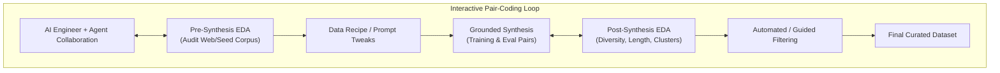

# Research: AI Engineer Pair-Coding Assistant for Dataset EDA (Exploratory Data Analysis)

## 1. Executive Summary

When AI Engineers build datasets for fine-tuning or model evaluation, **Exploratory Data Analysis (EDA)** is the critical differentiator between high-performing models and models that hallucinate or overfit. Traditional EDA focuses on tabular data (means, medians, null counts), whereas **LLM Dataset EDA** focuses on semantic diversity, token length distributions, topic clustering, noise/boilerplate ratios, and grounding faithfulness.

Transforming this project into a **Pair-Coding Assistant** means the agent doesn't act as a static generator. Instead, it collaborates side-by-side with the AI Engineer as an interactive partner:
1. **Auditing raw source data** (scraped web pages, documentation, seed files) before generation.
2. **Generating executable Python EDA scripts & data recipes** (using pandas, scikit-learn, Lilac/Data-Juicer concepts).
3. **Evaluating synthetic data post-generation** (inspecting clustering, complexity, and coverage).
4. **Iteratively refining filtering rules** based on live findings.

---

## 2. The Two Phases of LLM Dataset EDA

### Phase A: Pre-Synthesis EDA (Raw Web / Seed Corpus Audit)
Before asking an agent to generate hundreds of training pairs, the engineer must understand the source data:
- **Corpus Volume & Token Distributions**: Histogram of tokens per page/chunk, identifying truncated or sparse documents.
- **Noise & Boilerplate Ratio**: Percentage of HTML tags, navigation breadcrumbs, cookie notices, and repetitive boilerplate.
- **Topic & Domain Clustering**: Embedding the chunks (e.g., using fast embeddings + MiniBatchKMeans / UMAP) to see what topics dominate and what domains are missing.
- **Language & PII Check**: Detecting language consistency (e.g., unexpected foreign text) and checking for leaked emails, IP addresses, or secrets.

### Phase B: Post-Synthesis EDA (Synthetic Dataset Diagnostics)
Once training or evaluation samples are produced, the assistant runs diagnostic checks:
- **Instruction & Response Length Balance**: Density plots comparing prompt lengths vs. response lengths to detect response truncation or robotic brevity.
- **Semantic Diversity & Collapse**: Mapping prompts in 2D embedding space to ensure the model isn't generating 50 rewordings of the same question.
- **Difficulty & Complexity Spread**: Quantifying readability (Flesch-Kincaid) and reasoning depth (simple fact lookup vs. multi-step reasoning).
- **Faithfulness & Grounding Score**: Checking overlap and semantic alignment between the source chunk and the synthetic answer to catch hallucinations.

---

## 3. Pair-Coding Interaction Model

How does the AI Engineer interact with the assistant during pair coding?

| Engineer Intent | Assistant Action | Output Artifact |
|---|---|---|
| *"Audit this scraped documentation"* | Computes token distribution, top keywords, topic clusters, and flags noisy chunks. | Executive EDA Summary + Distribution Metrics |
| *"Help me find duplicate or near-duplicate instructions"* | Runs semantic similarity matrix / MinHash LSH and displays duplicate clusters with similarity score. | Duplicate Report + One-click Pruning Code |
| *"Show me prompt topic coverage"* | Generates a 2D cluster map or top-10 topic breakdown with sample counts. | Interactive Topic Breakdown / Python plot script |
| *"Filter out responses under 50 words or with low grounding"* | Drafts a declarative Data-Juicer or Pandas filter recipe for the engineer to review and apply. | Python Filter Recipe / Updated Dataset Slice |

---

## 4. Recommended EDA & Diagnostic Stack

1. **Lightweight EDA Core (Zero Extra Infra)**:
   - `pandas` + `numpy`: Tabular aggregation, quantiles, and length distributions.
   - `tiktoken` / Hugging Face `tokenizers`: Exact token counting matching target models (Llama, GPT, Claude).
   - `scikit-learn` (TF-IDF + KMeans): Fast, zero-GPU topic clustering and outlier detection.
2. **Deep Semantic Profiling (Agent-Assisted)**:
   - Sentence embeddings (e.g., `all-MiniLM-L6-v2` or OpenAI embeddings) for cosine similarity matrices and semantic coverage.
   - LLM-as-a-Judge for automated faithfulness scoring on random sample subsets.
3. **Data Recipe Framework**:
   - Declarative data-cleaning rules (inspired by **Data-Juicer** and **Lilac**) saved as versioned YAML/JSON recipes alongside the dataset.

---

## 5. Architectural Blueprint for the Pair-Coding Agent

To support this in our platform:
- **Workspace UI**: Split-view with chat/pair-coding on one side and live EDA charts/tables on the other.
- **EDA Execution Sandbox**: An environment where the agent can run analysis scripts on the active dataset in memory and return structured metrics.
- **Recipe Versioning**: Every EDA action (filter out short answers, drop cluster #3, deduplicate) is recorded in an audit trail (`recipe.yaml`) so the dataset is 100% reproducible.
