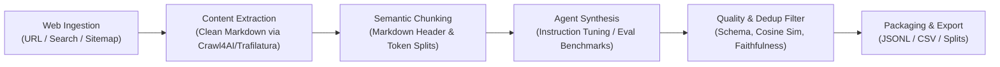

# Research: Web-Grounded Synthetic Dataset Generation for LLM Training and Evaluation

## 1. Executive Summary

This document provides architectural research and workflow design for building an automated agent that ingests raw data from the internet (web pages, documentation, search results, articles) and synthesizes high-quality datasets for **Model Training** (fine-tuning, instruction following) and **Model Evaluation** (benchmarks, golden test sets, grading rubrics).

Modern AI systems rely on **synthetic data pipelines** (such as Argilla Distilabel, Crawl4AI, and Microsoft Cosmos/Evol-Instruct). Rather than using raw scraped HTML, production pipelines follow a 4-stage pipeline:
1. **Intelligent Web Extraction**: Fetching target URLs/domains, rendering JavaScript when necessary, and stripping boilerplate (ads, navbars, cookies) into clean Markdown.
2. **Semantic Document Chunking**: Chunking text along header boundaries and structural sections with token overlap.
3. **Grounded Agentic Synthesis**: Passing clean context into specialized generation templates (Self-Instruct, Evol-Instruct, Multi-turn Chat, QA-with-Rubrics).
4. **Filtering & Deduplication**: Ensuring schema compliance, removing near-duplicates, and validating ground-truth faithfulness.

---

## 2. In-Depth Workflow: From Web to Training & Eval Data

### Stage 1: Web Data Collection & Noise Removal
- **Problem**: Raw web pages contain between 40% and 70% non-content noise (scripts, headers, footers, tracking pixels, ads, sidebar links). Feeding this into an LLM wastes tokens and produces garbage data.
- **Solution**:
  - **Asynchronous Crawling**: Support single URLs, URL batches, or crawling a sitemap.
  - **Boilerplate Pruning**: Use heuristic DOM pruning (e.g., Trafilatura or Crawl4AI LXML pruning) to extract pure textual content.
  - **Format Conversion**: Convert web content directly into structured Markdown, preserving headers (`#`, `##`), tables, and code snippets, which maintain semantic meaning.

### Stage 2: Content Preprocessing & Chunking
- **Header-Aware Chunking**: Splitting by Markdown headers ensures that an entire concept (e.g., a documentation subsection) stays within a single context window.
- **Target Chunk Size**: Typical optimal context window for synthetic generation is 1,500–3,000 tokens per chunk.
- **Deduplication at Ingestion**: Run MinHash LSH or MD5 on chunks to avoid scraping the same terms-of-service or repeated disclosures across pages.

### Stage 3: Grounded Data Generation (Training vs. Evaluation)

#### A. Model Training (Instruction / Fine-Tuning)
To train or fine-tune models, we need diverse inputs and comprehensive outputs.
- **Direct QA / Instruction Extraction**: Given a chunk, generate a natural question a human user would ask and an expert response based strictly on the text.
- **Evol-Instruct (Complexity Escalation)**: Mutate simple questions into harder variations (add constraints, ask for comparative analysis, introduce edge cases).
- **Multi-Turn Conversation**: Simulate a user asking a follow-up question and an assistant clarifying or expanding on the previous answer.

#### B. Model Evaluation (Golden Benchmark Sets)
Evaluation datasets must be strict, verifiable, and difficult enough to differentiate model capabilities.
- **Test Prompt**: An unambiguous question or task targeting domain concepts.
- **Reference Ground Truth**: The exact correct answer supported by the crawled documentation.
- **Grading Rubric / Criteria**: Explicit guidelines for an LLM judge or human annotator (e.g., *"Score 5/5 if it mentions X, Y, and warns about Z. Deduct 2 points if X is omitted"*).
- **Negative & Adversarial Cases**: Synthesize trick questions or out-of-context edge cases where the correct response is to recognize missing information or state uncertainty.

### Stage 4: Automated Quality Control & Faithfulness
Because the user specified that manual verification should not be mandatory, the system should employ automated guardrails:
1. **Schema Validation**: Ensure every generated item parses strictly as valid JSON according to the task preset.
2. **Faithfulness / Grounding Check**: A quick secondary check or prompt constraint verifying that the generated answer is derived directly from the source chunk.
3. **Semantic Deduplication**: Flag or drop samples with cosine similarity ≥ 0.90 against existing items to prevent dataset repetition.

---

## 3. Technology Stack Comparison

| Component | Recommended Tool / Pattern | Alternative / Trade-off |
|---|---|---|
| **Web Crawling / Scraping** | **Crawl4AI** or **Trafilatura** (Open-source, lightning fast, converts HTML to clean Markdown with noise pruning) | Puppeteer / Playwright raw (More complex, requires custom DOM cleaning) |
| **Pipeline Orchestration** | **Distilabel** (Specialized for synthetic dataset generation, built-in Evol-Instruct and LLM-as-a-judge) | Custom Python batching loop (Simple, fewer dependencies) |
| **Data Cleaning** | **LXML / BeautifulSoup + Markdownify** | Readability.js / Postlight Parser |
| **Deduplication** | **Embedding Cosine Sim + MinHash LSH** | Exact string matching (Misses rephrased duplicates) |
| **Export Serialization** | **JSONL (OpenAI/Hugging Face standard) + CSV** | Parquet (Good for huge datasets, but less universally editable) |

---

## 4. Key Challenges & Mitigation Strategies

1. **Anti-Bot & Rate Limits on Target Websites**:
   - *Mitigation*: Respect `robots.txt`, set reasonable request delays (concurrency limit 2–5 requests/sec), and use standard user-agent rotation.
2. **Hallucination Beyond Web Context**:
   - *Mitigation*: In the generation prompt, explicitly instruct the model: *"Use ONLY the facts provided in the context snippet. If the context does not contain sufficient details to answer, output SKIP."*
3. **Token & Cost Management**:
   - *Mitigation*: Enforce sample ceilings per run (e.g., default 50–200 samples) and batch multiple instructions from a single large chunk.
4. **Legal & Copyright Compliance**:
   - *Mitigation*: Allow users to provide their own target URLs or domain whitelists; exclude copyrighted paywalls and sites disallowing AI scraping in `robots.txt`.

---

## 5. Next Steps & Recommended Action Plan

To transition this research into our Jira documentation architecture:
1. **Create an Epic** under `docs/requirements/web-grounded-dataset-agent/` covering:
   - **Story 1**: Web Ingestion & HTML-to-Markdown Extraction (URL inputs, Crawl4AI/Trafilatura integration, boilerplate removal).
   - **Story 2**: Chunking & Seed Grounding Pipeline (Semantic splitting and context packaging).
   - **Story 3**: Grounded Synthetic Generation (Generating instruction pairs & evaluation benchmarks with rubrics from web chunks).
   - **Story 4**: Automated Grounding & Deduplication Filter (Faithfulness check and deduplication).
   - **Story 5**: Dataset Export with Splits (JSONL/CSV package download).
